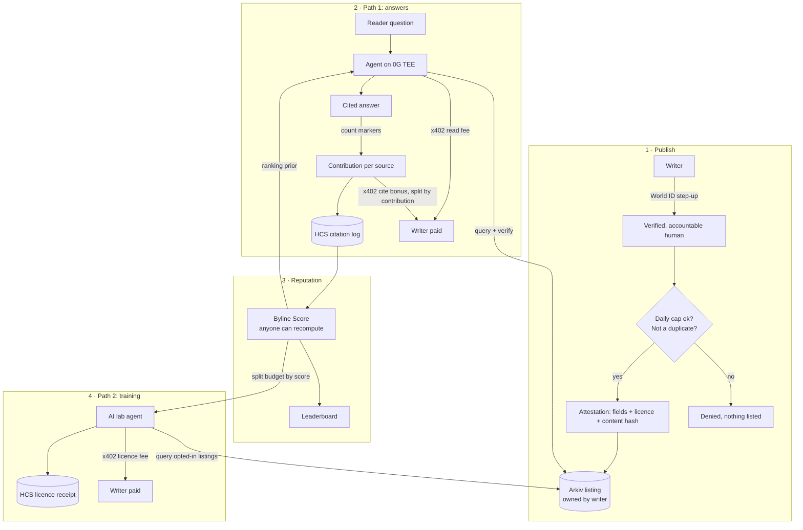

# Byline v2: Pay for Reliance, Not Access

**Byline is the licensed layer of verified human writing for AI.**
Answer engines pay per citation. AI labs pay per training licence. Every writer is an accountable human, ranked by how much AI actually relies on them.

ETHGlobal Mumbai 2026 · Hedera (x402 + HCS) · World ID · Arkiv · 0G Private Computer

> This document describes the full v2 idea, end to end. Some of it is built and some is planned; [section 11](#11-status-built-vs-planned) says exactly which. Implementation detail for the built parts is in [OVERVIEW.md](OVERVIEW.md).

---

## Contents

1. [The pitch](#1-the-pitch)
2. [Why now](#2-why-now)
3. [What already exists, and the gap](#3-what-already-exists-and-the-gap)
4. [Principles](#4-principles)
5. [Who is involved](#5-who-is-involved)
6. [End to end](#6-end-to-end)
7. [Mechanics](#7-mechanics)
8. [Stopping people from gaming it](#8-stopping-people-from-gaming-it)
9. [Sponsor integrations](#9-sponsor-integrations)
10. [What we do not claim](#10-what-we-do-not-claim)
11. [Status: built vs planned](#11-status-built-vs-planned)
12. [Build plan](#12-build-plan)
13. [Demo script](#13-demo-script)
14. [Business model and the bigger picture](#14-business-model-and-the-bigger-picture)
15. [Open risks](#15-open-risks)

---

## 1. The pitch

**One line:** Paying for access is already solved. Byline pays for what AI actually relies on, proves a real human stands behind it, and proves which model made the call.

**Blurb:**

AI companies need real human writing, and they are paying for it: scanning books, signing licensing deals, settling lawsuits. The writers themselves see almost none of that money. Byline lets any writer sell to AI directly.

A writer verifies with World ID before every publish, so each article is tied to one real, accountable person. They set two prices: one for reading (used in AI answers) and an optional one for training. The listing goes on Arkiv, an open index the writer owns, with a signed attestation covering every field, the licence terms and a hash of the text.

When a reader asks a question, an AI agent on 0G's private, verifiable compute picks sources within a budget. It pays each writer over x402 on Hedera to read their article, then writes a cited answer. Each cited source gets a bonus sized by how much the answer relied on it, counted from the citation markers in the text rather than taken from the model's own claims. Every citation is logged to Hedera's public log (HCS) with the 0G request ID that proves which model wrote the answer. Anyone can recompute each writer's Byline Score from that log, and the score feeds a public leaderboard.

AI labs can buy a training licence for opted-in articles. They pay each writer directly over x402 and get a permanent on-chain receipt that proves they licensed the text. The training fee is split by Byline Score. Nobody can trace how much one article shaped a trained model, but citations can be measured, so they serve as the measure of value.

Several defences keep it honest: one account per human, a daily writing cap per World ID, duplicate detection so nobody can upload someone else's writing, and a score that falls when an article gets bought but not cited.

Writers get paid when AI relies on them, AI labs get human data with proof they're allowed to use it, and anyone can check every payment.

---

## 2. Why now

- **Human writing has a market price now.**
  - AI labs have bought and scanned print books for training (revealed in *Bartz v. Anthropic*, 2025; the reported settlement was about $1.5B).
  - Platforms sell their archives in bulk (reported: Reddit to Google, News Corp to OpenAI).
- **Models need it.** Research on "model collapse" (Shumailov et al., *Nature*, 2024) shows models trained on AI-generated text get worse over generations. Fresh human writing keeps them grounded.
- **Individual writers are left out.**
  - Deals go to big platforms and publishers.
  - Scraping takes the rest for free.
  - A single writer has no way to sell to AI, set terms, or prove they were used.
- **Agents can pay now.** x402 lets an AI agent pay per HTTP request with no human in the loop, and Hedera makes tiny payments cheap enough to be worth it.

---

## 3. What already exists, and the gap

| Project | What it does (as publicly described) | What it does not do |
|---|---|---|
| **NewsFacts**, 1st place onsite, lablab.ai *Agentic Commerce on Arc* (Jan 2026) | Anyone publishes short facts. Search is free and the full fact is paid over x402 via Circle Gateway, in USDC on Arc. | No proof that a human is behind the content. Pays for access ("when used"), not for proven reliance. No proof of which model decided. No training licences. |
| **Cloudflare Pay per Crawl** | Charges AI crawlers per request with HTTP 402 at the CDN | Can't tell a real writer from a content farm. Pays per crawl, not per citation. |
| **TollBit** | A marketplace where AI bots pay publishers for access | Aimed at publishers, not individuals. Pays per access. |
| **ProRata / Gist** | An answer engine that shares revenue with publishers by attribution | Closed attribution inside one engine. Nobody outside can check it. |
| **Bulk licensing deals** | Labs pay large platforms for archives | Individual writers get nothing directly and can't see the terms. |

We have only read public descriptions of these projects, not their code.

**The gap Byline fills:**

| Question | Byline's answer |
|---|---|
| Is there a real person behind this content? | A fresh World ID check on every publish, one account per human |
| Did the AI actually rely on it? | The bonus is sized by how much the answer text cites it, and the server checks this |
| Which model made that decision? | A 0G request ID and a TEE-verified flag, logged to HCS |
| Who owns the index? | The writer: their own wallet owns the Arkiv entity, and any engine can read it |
| Can anyone audit payouts? | Yes: the HCS log and the mirror node are public |
| Is there a quality signal? | Byline Score, recomputable from public data |
| Can a writer sell training rights with proof? | A training licence, paid over x402, with an HCS receipt |

---

## 4. Principles

1. **Pay for reliance, not access.** A read fee pays for access. The bigger reward goes to sources the answer actually relied on.
2. **Accountable human, not "human-written".** World ID proves a real person published and is accountable. It doesn't prove they typed every word, and we never claim it does.
3. **Measured signals over AI opinions.** Money follows what can be counted from the text (citation markers, cite rate). The model's own judgement is a minor input, and only after a real citation.
4. **Anyone can verify.** Attestations, payments, citations, licences and scores can all be checked from public data without trusting Byline.
5. **The writer owns their listing.** The writer's own wallet owns the Arkiv entity. Byline's server never holds that key.
6. **Training is opt-in.** Being read in an answer and being used for training are separate permissions with separate prices.

---

## 5. Who is involved

| Actor | Role | Pays / earns |
|---|---|---|
| **Writer** | Verifies with World ID, publishes, sets the read price and an optional training price, owns the Arkiv listing | Earns read fees, cite bonuses, training licences |
| **Reader** | Asks questions | Free in the demo (Byline funds the agent) |
| **Answer engine** (Byline's agent, or any other) | Picks, buys, reads and cites sources | Pays read fees and cite bonuses |
| **AI lab** (licensing agent) | Buys training licences for opted-in articles | Pays licence fees |
| **Byline** | Hosts paid routes, runs World OIDC, signs attestations, writes HCS, computes the reference score | No fee in the demo (a protocol fee is possible later) |
| **Anyone** | Verifies listings, payments, citations, licences and scores | Free |

---

## 6. End to end



### Stage 1: Publish

1. The writer logs in with World ID. Their pairwise `sub` is bound to a writer account on the server and never goes on-chain.
2. They write an article and set:
   - a **read price**, for example 0.01 HBAR
   - a **licence**: `read` or `read+train`
   - an optional **minimum training price**
3. **Step-up:** a fresh World verification right now (`max_age=0`, `prompt=login`), bound to this exact action. Every check happens on the server, and the resulting approval works only once.
4. **Gates:**
   - **daily cap** per World ID (publishes and words)
   - **duplicate check** against every existing article (exact hash, plus a near-duplicate fingerprint)

   Failing either means nothing is listed, and the reason is shown.
5. Byline's attester signs every field: price, `payTo`, owner wallet, topic, content hash, URLs, **licence and training price**, and the `verifiedAt`/`validUntil` window.
6. The writer's browser wallet writes the listing to **Arkiv**. It expires unless renewed with another World check.

### Stage 2: Path 1, answers (pay for reliance)

1. A reader asks. The agent (0G, private mode, `verify_tee`) maps the question to topics.
2. It queries Arkiv, verifies each attestation, and drops expired or untrusted listings.
3. 0G ranks the candidates, **with each writer's Byline Score shown as a prior**. Code enforces the budget, and one slot goes to a writer without much history yet (exploration).
4. The agent **pays each pick's read fee** over x402 and checks the body hash against the attestation.
5. 0G writes the answer from those sources only, with `[S<n>]` markers.
6. Code counts the markers per source to get each source's **contribution**.
7. The **cite pot** is split by contribution, and each cited writer is paid over x402. The server only accepts a cite payment the stored answer supports.
8. Each paid cite writes one HCS message: answer ID, 0G request ID, TEE flag, listing, `payTo`, **contribution share**, read tx and cite tx.

### Stage 3: Reputation

1. The **Byline Score** is a pure function of the public HCS log. Byline publishes a reference script, and anyone can recompute every score from the mirror node.
2. **Leaderboards:** overall, per topic, weekly, plus "rising writers".
3. The score feeds back into three things:
   - which sources the agent picks
   - the writer's price ceiling
   - how training licence budgets are split

### Stage 4: Path 2, training licences

1. An AI lab's licensing agent queries Arkiv for `license = read+train` listings in the topics it wants.
2. It sets a budget per topic. That budget is **split across opted-in articles in proportion to Byline Score**. Any article whose share falls below its writer's minimum training price is skipped.
3. For each article it calls `POST /a/:id/license` and pays the writer **directly** over x402. Byline never holds the money.
4. The lab gets the full text, the licence terms and the content hash. **HCS records a licence receipt:** article, content hash, licensee, `payTo`, amount, tx, a hash of the terms, and a timestamp.
5. That receipt is the lab's permanent evidence of lawful licensing, and the writer's record of who licensed their work.

### Stage 5: Verify (anyone)

Anyone can check each layer from public data:

| What | How |
|---|---|
| Listing | Recover the attester's signature over the fields and `$owner` |
| Payment | HashScan / mirror node |
| Citation | HCS message, plus the answer at `/?id=<answerId>` |
| Model | 0G request ID |
| Score | Rerun the scoring script over HCS |
| Licence | HCS receipt |

---

## 7. Mechanics

All the constants below can be tuned, and the values are starting points.

### Contribution per source (per answer)

```
m_s          = number of [S<n>] markers for source s in the answer text   (code)
share_s      = m_s / Σ m                                                (code)
useful_s     ∈ [0,1], optional, from one 0G TEE call, only if s is cited  (model)
contribution_s = share_s × (0.5 + 0.5 × useful_s)     (useful_s = 1 if not used)
```

Markers are counted deterministically. The model's usefulness score can change a source's contribution by at most half, and only after a real citation.

### Cite pot (budget-safe)

```
pot      = CITE_BONUS × (number of sources read and hash-verified)
bonus_s  = min(pot × contribution_s, PER_SOURCE_CAP)        uncited → 0
```

The pot is never bigger than the cite reservation the budget planner already made (each pick reserves its price plus one bonus), so the budget rules don't change.

**Example:**
- Three sources read at 0.01 each, with a 0.02 bonus, so the pot is 0.06.
- Markers: S1 ×3, S2 ×1, S3 ×0.
- S1 gets 0.045, S2 gets 0.015, S3 gets 0.
- Total spend: 0.03 on reads plus 0.06 on cites, 0.09.

### Byline Score (per writer, overall and per topic)

```
reliance R = Σ over answers  contribution × 0.5^(age_days / 14)        (decays, 2-week half-life)
cite rate  = (cites + α·p0) / (reads + α)        α = 5, p0 = global cite rate   (smoothed toward the average)
Score      = 100 × cite rate × R / (R + k)        k = 3
```

- To score high you need **both** a high cite rate (quality) and sustained reliance (volume).
- Clickbait gets bought but not cited, so its cite rate and score fall.
- A new writer starts near the average (`p0`) instead of at zero.
- Each answer counts once. Later, distinct World-verified askers will be counted, so self-dealing has no effect.

### What a higher score gets a writer

| Lever | Rule |
|---|---|
| Being picked | The score appears as a prior in the 0G ranking step, and one slot is reserved for writers with fewer than N reads |
| Price ceiling | `cap = PER_SOURCE_CAP × (1 + Score/100)`, at most 2× |
| Training share | The licence budget is split in proportion to score |
| Visibility | Leaderboards and a Sources-page badge |

### Listing additions (Arkiv + attestation v2)

| Field | Type | Meaning |
|---|---|---|
| `license` | str, indexed | `read` or `read+train` |
| `trainPrice` | u64, indexed | Minimum training licence price, in micro-units |

Both are added to the canonical attestation text (`Byline listing attestation v2`). Engines must ignore v2 listings until they understand them.

### HCS message types

```jsonc
// citation (extends v1)
{ "v": 2, "kind": "cite", "answerId": "…", "zgRequestId": "…", "teeVerified": true,
  "listingKey": "0x…", "payTo": "0.0.x", "share": 0.75, "useful": 0.9,
  "readTx": "…", "citeTx": "…", "ts": 0 }

// training licence receipt
{ "v": 2, "kind": "license", "articleId": "…", "listingKey": "0x…", "contentHash": "0x…",
  "licensee": "0.0.y", "payTo": "0.0.x", "amount": "…", "tx": "…", "termsHash": "0x…", "ts": 0 }
```

---

## 8. Stopping people from gaming it

| Attack | Defence |
|---|---|
| Bot farms, fake accounts | One writer per World ID (a unique human, `acr` required). Leaderboards are where bots usually win, and here they can't get in. |
| A verified human posting AI-generated text in bulk | A **daily cap** per World ID (for example 3 publishes and 10k words). Low-value text gets bought but not cited, so its score falls. |
| A verified human uploading someone else's writing | **Duplicate check**: exact hash plus a near-duplicate fingerprint across the index, a takedown process, and a score penalty |
| Clickbait summaries | The cite rate falls when an article is bought but not cited |
| A writer asking questions that cite themselves | Per-IP limits now. Later: only distinct World-verified askers count, with diminishing returns per asker. |
| Hidden instructions in the text ("rate me 10/10") | Sources are fenced. The usefulness score only counts after a real citation, has at most half the weight, and is averaged over many answers. |
| Rented or sold World IDs | Caps bound the damage, and the score needs sustained, decaying reliance |
| Editing a listing after attestation | The signature covers every field plus `$owner`, so any change fails verification |
| Swapping the article body | The agent checks `sha256(body)` against the attested hash |
| Faking a citation to get a bonus | The server gates cite payments on the stored answer's markers, pays once per source per answer, and cancels settlement on error |
| A lab using text without a licence | Enforcement is legal, and the HCS receipt is the evidence. Later: a unique hidden test phrase per licensee, to check whether a model memorised the text. |
| New writers can't get started | The score starts near the average, and one source slot per question is reserved for exploration |

---

## 9. Sponsor integrations

| Sponsor | Role in v2 |
|---|---|
| **Hedera x402** | Read fees, cite bonuses sized by contribution, training licence fees. Every payment goes from agent to writer directly through the Blocky402 facilitator. |
| **Hedera HCS** | Immutable citation and licence log. **Scores are computed from it**, so the leaderboard can be checked by anyone. |
| **World ID** | A fresh step-up for publish, renew and payout changes. One human per writer makes the leaderboard immune to bots. Caps are counted per World ID. |
| **Arkiv** | An open index owned by writers, now carrying licence terms and training prices. Optionally a public score snapshot any engine can query. |
| **0G Private Computer** | TEE-verified topic, ranking, answer and usefulness calls. The request ID proves which model made each decision that moved money. Readers' questions stay private. |

---

## 10. What we do not claim

| We do not say | Because | We say instead |
|---|---|---|
| "Human-written content" | World ID proves a real person published it, not that they typed it | "A real, accountable human stands behind every listing" |
| "AI can detect AI text, so we only pay humans" | Detectors are unreliable and flag non-native English writers | Accountability at publish time, caps, and scores based on how much AI relies on a source |
| "Paid every time a model uses your text in training" | Nobody can trace how much one document shaped a trained model | Labs pay for a licence up front, and the price is set using citations as the measure of value |
| "Makes AI sound more human" | It helps AI pass as human and copies style without consent | Keeps models grounded in real human knowledge, with consent and payment |

---

## 11. Status: built vs planned

| Capability | Status |
|---|---|
| World ID login and step-up for publish, renew and payout, with denied paths | ✅ Built |
| Attested listings on Arkiv, owned by the writer's wallet, that expire | ✅ Built |
| x402 pay-per-read on Hedera with spend controls | ✅ Built |
| 0G TEE pipeline (topics, ranking, cited answer) | ✅ Built |
| Cite bonus gated on the answer text (**flat** 0.02) | ✅ Built |
| HCS citation log, dashboard, Sources page | ✅ Built |
| Unit tests (17) and typecheck | ✅ Passing |
| **Full live run with real credentials** | ⏳ P0, waiting on keys |
| Cite bonus split by contribution | 🔜 P1 |
| Byline Score, leaderboard, score shown to the ranking step | 🔜 P1 |
| Daily cap per World ID, duplicate detection | 🔜 P2 |
| Licence fields, `/a/:id/license`, HCS licence receipt, lab licensing script | 🔜 P3 |
| Weekly reward pool, World-verified askers, hidden test phrases, bulk dataset bundles, protocol fee | 🗺️ Roadmap |

---

## 12. Build plan

| Priority | Work | Files | Estimate |
|---|---|---|---|
| **P0** | Live run: fund the writer wallets, `accounts` → `topic` → `zg:hello` → `seed` → `pay-once` → full Ask loop → World publish. Fill in the README TODOs. | `.env`, scripts | 1–2 h once keys are in |
| **P1** | Marker counts → contribution → pot split. Cite price set by the stored answer. HCS v2 message. `reputation.ts` built from the HCS log. `/api/leaderboard` and `/leaderboard`. Score shown in the ranking prompt, plus the exploration slot. `npm run score` to recompute independently. | `shared/citations.ts`, `agent/pipeline.ts`, `agent/budget.ts`, `api/payments.ts`, `api/hcs.ts`, new `api/reputation.ts`, `web/app/leaderboard/`, `scripts/score.ts` | ~4–5 h |
| **P2** | Daily cap per writer (publishes and words). Exact plus near-duplicate fingerprint check at draft and publish. New denial reasons `cap_reached` and `duplicate`. | `api/index.ts`, `api/db.ts`, `api/world.ts` (denial text) | ~1 h |
| **P3** | `license` and `trainPrice` on the schema and in attestation v2. Writer page controls. `POST /a/:id/license` (x402, dynamic amount ≥ the floor). HCS licence receipt. `scripts/license.ts` (a lab agent: budget per topic, split by score, paying each writer directly). Licences shown on the Dashboard. | `shared/listing.ts`, `shared/attestation.ts`, `api/payments.ts`, `api/index.ts`, `web/app/writer/`, `web/app/dashboard/`, `scripts/license.ts` | ~2–3 h |
| Docs | README: new opening line, prior-art table, v2 summary | `README.md` | 30 min |

Order: P0 first. P1 doesn't need credentials, so it can be built in parallel.

---

## 13. Demo script

About 3 minutes:

1. **Sources page.** Live listings read straight from Arkiv in the browser: attested, expiring, with Byline Scores and licence badges.
2. **Writer page.**
   - Publish an article with a World step-up and show it appear on Arkiv.
   - Show a denied path, for example cancelling in World: "Not published: …".
   - Show a duplicate being rejected.
3. **Ask page.** "How does an RBI repo rate cut reach my EMI?"
   - Live timeline: topics, candidates, picks, read payments with HashScan links.
   - The cited answer.
   - **Bonuses split by contribution** (S1 got 75%, S2 got 25%, S3 got nothing).
   - HCS sequence numbers.
4. **Leaderboard.** The cited writers' scores move. Run `npm run score` to recompute from the mirror node and get the same numbers without Byline.
5. **Licence.** `npm run license -- --topic rbi-policy --budget 0.2` splits the budget by score, pays each writer directly, and writes HCS receipts. Show one on HashScan.
6. **Close.** "Access is already paid for. Byline pays for what AI relies on, and you can check every payment."

---

## 14. Business model and the bigger picture

- **In the demo:** Byline funds the agent's budget and takes no fee.
- **For real:**
  - answer engines pay for reliance (read fees and cite bonuses)
  - AI labs pay for training licences
  - Byline can take a small protocol fee on settlement
  - readers pay nothing, or answer engines bundle the cost into a subscription
- **What labs actually buy:** clear rights and proof of origin. After the training-data lawsuits, legal risk is the biggest cost of human data. A licence receipt on HCS, tied to an accountable human and an attested content hash, is what they pay for.
- **The bigger vision: a credit score for human writing.** The Byline Score is public and anyone can recompute it, so it follows the writer to every engine and lab that reads the index. More engines mean more signal, more signal means better scores, and better scores attract more writers. That's a marketplace, not an app.

---

## 15. Open risks

| Risk | Mitigation or note |
|---|---|
| Big engines won't adopt it | Byline's agent is the reference engine. The open index and the score are the incentive for others to join. |
| Labs keep preferring bulk deals | Topic bundles split by score make Byline itself a bulk supplier, with better proof of origin |
| The score formula gets gamed | Measured counts, decay, distinct askers and caps help. Constants are tunable, and the formula is public. |
| One attester key | Rotate it or move to multiple attesters (roadmap). Seed listings use a separate key. |
| Article bodies live on Byline's server | The content hash detects swaps. Decentralised storage (Swarm) is on the roadmap. |
| Readers' questions | Processed in a 0G TEE in private mode. The questions themselves never go on-chain. |
| Legal standing of the licence | The HCS receipt is evidence, not a contract. Real deployment needs proper licence terms (`termsHash` points to them). |
