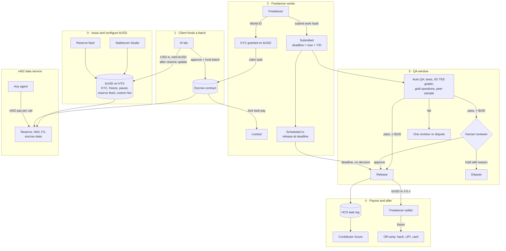
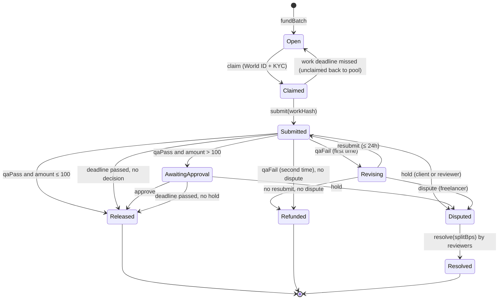
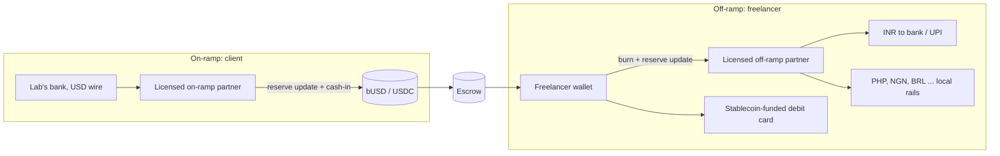

# Byline Work: Get Paid On Time for Training AI, From Anywhere

**Byline Work is an escrowed, cross-border payroll rail for the humans who train AI.**
AI labs lock the money for a task before anyone starts. A verified human does the work. QA gets 72 hours to decide. If QA passes, or nobody decides in time, the freelancer is paid in seconds in a USD stablecoin they own. Payouts over $100 need a human reviewer to sign off, but that reviewer can only stop a payment, not stall it.

ETHGlobal Mumbai 2026 · Hedera (Stablecoin Studio, HTS, Scheduled Transactions, HCS, x402) · World ID · 0G

> This extends [BYLINE_V2.md](BYLINE_V2.md). v2 paid writers when AI relied on their writing. Byline Work pays experts (coders, designers, finance, medicine, languages) who produce training data for AI on request, the way Outlier, Mercor and Handshake AI work today, and fixes how they get paid.

---

## Contents

1. [The problem](#1-the-problem)
2. [The pitch](#2-the-pitch)
3. [Principles](#3-principles)
4. [Who is involved](#4-who-is-involved)
5. [End to end](#5-end-to-end)
6. [The escrow: rules and state machine](#6-the-escrow-rules-and-state-machine)
7. [The stablecoin (Stablecoin Studio)](#7-the-stablecoin-stablecoin-studio)
8. [The x402 data service](#8-the-x402-data-service)
9. [How it connects to Byline v2](#9-how-it-connects-to-byline-v2)
10. [Future: fiat on and off ramps](#10-future-fiat-on-and-off-ramps)
11. [Stopping people from gaming it](#11-stopping-people-from-gaming-it)
12. [Prize requirements checklist](#12-prize-requirements-checklist)
13. [Architecture and repo layout](#13-architecture-and-repo-layout)
14. [Build plan](#14-build-plan)
15. [Demo script (under 5 minutes)](#15-demo-script-under-5-minutes)
16. [Hedera gotchas to check on day one](#16-hedera-gotchas-to-check-on-day-one)
17. [What we do not claim](#17-what-we-do-not-claim)
18. [Open risks](#18-open-risks)

---

## 1. The problem

AI labs now pay large numbers of human experts to write, rank and correct model outputs. The work is global, and a big share of the workers are outside the US. How they get paid hasn't caught up.

| Pain | What it looks like for a freelancer |
|---|---|
| **Late or uncertain pay** | Work is reviewed on the platform's schedule. Pay can be held, clawed back or delayed with no clear deadline, and the freelancer can't see whether the money even exists. |
| **Cross-border latency** | Payouts move through wires and payout processors. Days in transit, FX spreads, intermediary fees and minimum withdrawal thresholds. |
| **Platform token or currency locks** | Earnings sit as a platform balance or credit the worker can't move freely, only withdraw on the platform's terms, in the platform's chosen currency and rails. |
| **No proof of work history** | Your quality record lives inside one platform. Switch platforms and you start from zero. |
| **Bots and account farms** | Platforms fight fake and shared accounts, so honest workers face heavy checks and sudden bans. |

The lab side has problems too: they can't prove the humans were real, consented and paid, which matters more every month as training data provenance gets litigated.

---

## 2. The pitch

**One line:** The money is locked before the work starts, and silence pays the freelancer.

**Blurb:**

An AI lab posts a batch of tasks (for example, "review 50 Python solutions" or "rank 200 Hindi translations") and funds it in **bUSD**, a USD stablecoin issued with Hedera's **Stablecoin Studio**, with KYC, freeze, pause, a reserve feed and custom fees configured. The money moves into an **escrow contract** on Hedera, so the freelancer can see it's there before they start.

Freelancers join with **World ID** (one real human per account) and are granted KYC on the token. They claim a task, and the escrow locks that task's pay. When they submit, a **72-hour QA window** starts and a **Hedera Scheduled Transaction** is created to release the payment at the deadline.

- QA passes and the task is **$100 or less**: paid immediately.
- QA passes and the task is **over $100**: a human reviewer must approve. The reviewer can approve or put it on hold with a reason. If they do neither by the deadline, it pays out.
- QA fails: the freelancer gets one revision (at most 24 hours more) or can dispute.
- **Nobody decides by the deadline: the scheduled transaction fires and the freelancer is paid.** Anyone can also trigger the release after the deadline, so payment doesn't depend on Byline's servers.

Payment settles in 3 to 5 seconds, anywhere in the world, for a fraction of a cent. The freelancer holds a dollar stablecoin in their own wallet, not a platform balance. Every step is logged to **HCS**, which builds a portable **Contributor Score**. An **x402 data service** sells signed reserve, NAV and FX data about bUSD and the escrow pool to any agent that wants it.

---

## 3. Principles

1. **Fund before work.** No task can be claimed unless its pay is already locked in escrow.
2. **Silence pays the freelancer.** Every "wait" state has a deadline. When it passes with no decision, the default goes to the person who did the work.
3. **Humans can stop large payments, not stall them.** Over $100, a reviewer must act, but doing nothing doesn't block payment. Only an explicit hold with a reason does.
4. **The freelancer owns their money.** Payouts go to the freelancer's own wallet in a USD stablecoin. No platform credits, no minimum withdrawal.
5. **No platform token.** bUSD is a dollar stablecoin backed by a published reserve, not a speculative token. In production the escrow also accepts Circle's USDC on Hedera.
6. **Everything checkable.** Funding, QA decisions, approvals, releases and reserve updates are public on Hedera. Work content stays private, and only its hash goes on-chain.

---

## 4. Who is involved

| Actor | Role | Identity | Pays / earns |
|---|---|---|---|
| **Client** (AI lab) | Posts task batches, funds escrow, can raise a QA concern within the window | KYB (mocked in demo), Hedera account | Pays task amount plus platform fee |
| **Freelancer** | Claims, does and submits tasks, holds and withdraws bUSD | World ID (unique human) + KYC grant on bUSD | Earns task pay |
| **QA** | Automated checks (tests, rubric grader in 0G TEE, gold questions) plus sampled peer review | QA oracle key, peer reviewers are high-score freelancers | Peer reviewers earn a share of the fee |
| **Reviewer** (human in the loop) | Approves or holds payouts over $100, arbitrates disputes | Reviewer role on the escrow, a Hedera account with a threshold key | Paid from the platform fee |
| **Issuer / treasury** | Runs bUSD via Stablecoin Studio: mint, burn, KYC, freeze, reserve updates, fees | Stablecoin Studio role keys | Collects the custom fee |
| **Data buyers** | Pay per request over x402 for reserve, NAV, FX and escrow data | Any x402 client | Pay per call |
| **Anyone** | Verifies payments, reserve, scores | — | Free |

---

## 5. End to end



### Step 0: Issue and configure bUSD (once)

1. Create **bUSD** with Stablecoin Studio on Hedera testnet: 6 decimals, with the supply, wipe, freeze, KYC, pause and fee schedule keys handled by Stablecoin Studio's role-based setup.
2. Attach a **reserve data feed** (Stablecoin Studio supports a proof-of-reserve contract). Minting fails if it would push supply above the reserve.
3. Configure a small **custom fee** collected by the treasury (see [section 7](#7-the-stablecoin-stablecoin-studio)).
4. Grant KYC to the escrow contract and the treasury.

### Step 1: Client funds a batch

1. The lab sends USD to the issuer (a mock bank deposit in the demo). The issuer **updates the reserve**, then **cashes in** (mints) bUSD to the lab's account.
2. The lab creates a batch: task type, rubric, number of tasks, pay per task, QA window.
3. The lab approves the escrow to pull `tasks × pay + platform fee`, and calls `fundBatch`. The batch is now visible in the app with **"Funded: $X locked"**.

### Step 2: Freelancer claims and submits

1. The freelancer signs in with **World ID**. One World ID, one account. Byline grants KYC on bUSD to their wallet (in production, after a KYC provider check).
2. They pass a short qualification task for the vertical (coding, design, finance and so on).
3. They **claim** a task. The escrow moves that task's pay from the batch pool into a per-task lock, with a work deadline (for example 24 hours to submit).
4. They **submit**. The work goes to Byline's server (private), and `sha256(work)` goes to the contract. The contract sets `reviewDeadline = now + 72h`.
5. The backend creates a **Scheduled Transaction** that calls `release(taskId)` at `reviewDeadline`.

### Step 3: QA window (72 hours)

| Outcome | What happens |
|---|---|
| QA passes, task ≤ $100 | QA oracle calls `qaPass`. Paid immediately. Schedule is no longer needed (calling it later is a no-op). |
| QA passes, task > $100 | Task moves to `AwaitingApproval`. A reviewer calls `approve` (paid now) or `hold(reasonHash)` (dispute). If neither by the deadline, release goes ahead. |
| QA fails | `qaFail(reasonHash)`. The freelancer can revise once (the deadline moves out by at most 24 hours, so the total is never more than 4 days), or `dispute` within 24 hours. |
| Client objects | The client can `hold` within the window with a reason. This opens a dispute, which only a reviewer can resolve. |
| Nobody acts | At the deadline the scheduled transaction calls `release`. Anyone else can call it too. |

### Step 4: Payout

1. `release` sends bUSD to the freelancer and the fee to the treasury and the QA reviewer pool, in the same transaction.
2. HCS gets one message per state change: task ID, batch, hashes, amounts, tx IDs. No personal data.
3. The freelancer's **Contributor Score** updates from the HCS log.
4. The freelancer can hold bUSD, send it to anyone with an HTS account, or (future) off-ramp to a bank, UPI or card.

---

## 6. The escrow: rules and state machine



### Constants (tunable)

| Constant | Value | Why |
|---|---|---|
| `HITL_THRESHOLD` | 100 bUSD | Above this, a human reviewer is in the loop |
| `DUAL_REVIEW_THRESHOLD` | 1,000 bUSD | Above this, two reviewers must approve (optional tier) |
| `REVIEW_WINDOW` | 72 hours | QA must decide within 3 days |
| `REVISION_WINDOW` | 24 hours | One revision, total never over 4 days |
| `WORK_WINDOW` | Per batch, for example 24 hours | Stops people claiming tasks and sitting on them |
| `PLATFORM_FEE_BPS` | 300 (3%) | Paid by the client on top, so the freelancer gets the full posted pay |
| `DEMO_MIN_WINDOW` | 120 seconds | Testnet only, so the timeout can be shown live |

### Contract interface (sketch)

```solidity
// contracts/EscrowVault.sol (Hedera EVM, holds bUSD through its ERC-20 facade)
function fundBatch(bytes32 batchId, uint32 taskCount, uint64 payPerTask, uint32 reviewWindow) external;
function claim(bytes32 batchId) external returns (uint256 taskId);   // onlyVerifiedWorker
function submit(uint256 taskId, bytes32 workHash) external;          // onlyWorker(taskId)
function qaPass(uint256 taskId, bytes32 reportHash) external;        // onlyQaOracle
function qaFail(uint256 taskId, bytes32 reasonHash) external;        // onlyQaOracle
function approve(uint256 taskId) external;                           // onlyReviewer
function hold(uint256 taskId, bytes32 reasonHash) external;          // reviewer or client, before deadline
function dispute(uint256 taskId, bytes32 reasonHash) external;       // worker, after qaFail
function resolve(uint256 taskId, uint16 workerBps) external;         // reviewer(s)
function release(uint256 taskId) public;                             // anyone, if rules allow
function refund(uint256 taskId) external;                            // client, if rules allow
```

`release` is the important one. It pays out if:

- state is `Submitted` or `AwaitingApproval` and `block.timestamp >= reviewDeadline` and there's no hold, **or**
- it's called from within `qaPass` (≤ $100) or `approve`.

Because `release` is permissionless after the deadline, the scheduled transaction is a convenience, not a trust assumption. If Byline goes offline, the freelancer can call it themselves from HashScan or the app.

### Who is trusted for what

| Role | Can | Cannot |
|---|---|---|
| QA oracle (Byline backend, grader in 0G TEE) | Pass or fail a task with a report hash | Move money anywhere except to the worker (pass) or into the revision path (fail) |
| Reviewer | Approve, hold with reason, resolve disputes | Delay a payment without an on-chain reason, or pay anyone other than the worker or client |
| Client | Fund, hold with reason inside the window, get refunds on failed tasks | Take back locked pay once work is submitted, unless QA fails or a dispute resolves for them |
| Admin | Change roles, pause new batches | Touch funds already locked in tasks |

---

## 7. The stablecoin (Stablecoin Studio)

bUSD is a testnet USD stablecoin issued with Stablecoin Studio. It exists so the demo can show issuance and lifecycle operations. In production the escrow would also take USDC on Hedera, so there is no lock-in to Byline's coin.

| Feature | How Byline uses it | Prize "extra points" |
|---|---|---|
| **KYC key** | Only World-ID-verified freelancers, KYB'd clients, the escrow and the treasury can hold bUSD | Compliance controls |
| **Freeze** | Freeze a specific wallet caught in fraud (stolen World ID, account selling). Never used on the escrow itself. | Compliance controls |
| **Pause** | Emergency stop for the whole token | Compliance controls |
| **Transfer restrictions** | Follow from KYC: bUSD can't move to un-KYC'd accounts | Compliance controls |
| **Reserve feed** | Proof of reserve. Minting can't exceed the reserve. Updated on every deposit and redemption. | Oracle pricing / NAV feeds |
| **Cash-in / burn** | Mint when a lab deposits USD, burn when a freelancer redeems | Lifecycle operation |
| **Custom fees** | A small fee collected by the treasury on transfers (see below) | Custom fees and distributions |
| **Role management** | Separate keys for cash-in, burn, KYC, freeze, so no single key does everything | — |

**Custom fees, with a caution.** HTS custom fees apply to every transfer, including into and out of the escrow, so a fractional fee would be charged twice per task. Two options:

- **Recommended:** keep the HTS custom fee tiny and fixed (it funds network costs and shows the feature), and take the real 3% platform fee inside the escrow contract on release, where it's split between the treasury and the QA reviewer pool. That split is the "distribution".
- Or make the escrow a fee collector so it's exempt. Check exemption rules on testnet before relying on this.

**Lifecycle operations shown in the demo:** cash-in after a reserve update (lab deposit), KYC grant, freeze, and redemption (burn plus reserve update).

---

## 8. The x402 data service

This is the "x402 service that sells data about tokenized assets, such as NAV or price feeds" from the prize brief. Byline runs it, and any agent can pay per call over x402 on Hedera.

| Endpoint | Returns | Price (demo) | Who buys it |
|---|---|---|---|
| `GET /x402/busd/reserve` | Total supply, reserve amount, reserve ratio, last reserve update tx, signed by Byline | 0.001 HBAR | Wallets, exchanges, auditors, lab treasury agents |
| `GET /x402/busd/nav` | NAV per bUSD (reserve ÷ supply, should be 1.00), with history | 0.001 HBAR | Anyone pricing bUSD |
| `GET /x402/fx/:pair` | FX rate, for example `USD-INR`, `USD-PHP`, `USD-NGN`, with source and timestamp | 0.001 HBAR | Freelancer app (shows local value), future off-ramp quoting |
| `GET /x402/escrow/stats` | Value locked, tasks by state, median time to pay, share auto-released, dispute rate | 0.005 HBAR | Labs choosing a platform, researchers, freelancers choosing clients |
| `GET /x402/client/:id/stats` | A lab's funding history, average QA time, dispute rate | 0.005 HBAR | Freelancers deciding which batches to take |

- Every response is signed, and a hash of it is written to HCS, so a buyer can prove what the feed said at that moment.
- The FX source in the demo is a public FX API, clearly labelled. The reserve and escrow data come from Hedera itself, via the mirror node.
- `client/:id/stats` turns the usual direction around: freelancers can pay a cent to check whether a lab pays on time before accepting work.

---

## 9. How it connects to Byline v2

Byline Work reuses everything v2 built:

| v2 piece | Use in Byline Work |
|---|---|
| World ID step-up | Sign-up, claiming high-value tasks, changing payout wallet |
| One human per account, daily caps | Stops task farming and account renting |
| x402 on Hedera | The data service, plus labs buying finished datasets |
| HCS log | Task lifecycle log, and the source of the Contributor Score |
| Byline Score | Becomes the **Contributor Score**: QA pass rate, on-time rate, disputes lost, decayed over time, recomputable by anyone |
| Training licence receipt | When a batch completes, the lab gets an HCS receipt: task hashes, verified-human count, amounts paid, terms hash. That's proof the training data was made by real, consenting, paid people. |
| 0G TEE | Rubric grading for QA, so the model that judged the work is provable and lab prompts stay private |

**Contributor Score** (same shape as the v2 Byline Score):

```
pass rate   = (passes + α·p0) / (submissions + α)       α = 5, p0 = global pass rate
on time     = submitted before work deadline / claimed
volume V    = Σ task value × 0.5^(age_days / 30)
Score       = 100 × pass rate × on time × V / (V + k)    minus a penalty per dispute lost
```

A higher score unlocks higher-paying batches and higher per-task caps. Because it's computed from the public HCS log, a freelancer can take it to any other platform that reads it.

---

## 10. Future: fiat on and off ramps

The demo stops at "the freelancer holds dollars on Hedera in 3 seconds". In production, two adapters connect bUSD (or USDC) to banks and cards. Neither is built for the hackathon; the demo uses a mock.



```ts
// api/offramp/types.ts : what any partner adapter has to implement
interface OffRampProvider {
  id: string;                                   // "mock", later a real partner
  corridors(): Promise<Corridor[]>;             // e.g. USD -> INR via UPI
  quote(amount: bigint, corridor: string): Promise<Quote>; // rate, fee, ETA (rate from the x402 FX feed)
  payout(quoteId: string, burnTxId: string, dest: PayoutDest): Promise<PayoutStatus>;
  status(payoutId: string): Promise<PayoutStatus>;
}
```

- **Redemption is a Stablecoin Studio lifecycle operation:** the freelancer sends bUSD to the treasury, it's burned, the reserve is updated, and the partner pays out locally. In the demo the partner is `MockOffRamp`, which shows "₹ credited" and marks itself as a simulation.
- **Cards:** a card issuer that funds spend from a stablecoin balance plugs in as another provider.
- **What changes for the freelancer:** pay arrives the moment QA passes, in dollars they control. They choose when and how to convert, and they can compare quotes.

---

## 11. Stopping people from gaming it

| Attack | Defence |
|---|---|
| Bot farms, many accounts per person | One account per World ID. KYC grant on bUSD is tied to that account. |
| Renting or selling verified accounts | World ID step-up on claiming tasks over $100 and on changing payout wallet. Freeze on confirmed fraud. |
| Claiming tasks and sitting on them | Work window. Unsubmitted tasks go back to the pool, and on-time rate is part of the score. |
| Submitting junk and hoping QA times out | Auto QA runs within minutes of submission, so a timeout only happens if Byline itself fails, which is Byline's cost to bear. Per-worker caps limit exposure for new accounts. |
| A client refusing to approve to avoid paying | The client has no approval step. They can only hold with a reason, which goes to a reviewer, and every hold is public on HCS and in `client/:id/stats`. |
| A reviewer stalling a big payout | Doing nothing doesn't block payment. Only an on-chain hold with a reason does, and reviewers' hold rates are tracked. |
| A reviewer colluding with a freelancer | Over $1,000 needs two reviewers. Peer QA is sampled and cross-checked against gold questions. |
| Using AI to do the "human" work | World ID proves an accountable person, not that they typed it. Gold questions, rubric grading and pass-rate scoring handle quality. Same honesty as v2: we don't claim AI detection. |
| Leaking lab prompts or data | Work content stays off-chain, only hashes on-chain. Grading runs in a 0G TEE. |
| Faking the reserve | The reserve feed update is a signed on-chain tx, the x402 NAV feed shows history, and minting is blocked above the reserve. In production the reserve would come from an attested custodian. |

---

## 12. Prize requirements checklist

From the Hedera brief you pasted:

| Requirement | How Byline Work meets it |
|---|---|
| Use ATS or Stablecoin Studio to issue or manage a tokenized asset or stablecoin | bUSD issued and managed with Stablecoin Studio (SDK for scripts, web app for the demo) |
| Deploy and demo on Hedera testnet | Everything on testnet: bUSD, escrow, schedules, HCS topic, x402 payments |
| Public GitHub repo, contracts verified on HashScan | `EscrowVault.sol` and the reserve feed verified on HashScan |
| Demo video ≤ 5 min covering issuance, configuration and at least one lifecycle operation | See [section 15](#15-demo-script-under-5-minutes): issuance, KYC/fee/reserve configuration, cash-in, freeze, redemption |
| x402 service selling data about tokenized assets (NAV, price feeds) | [Section 8](#8-the-x402-data-service): reserve, NAV, FX and escrow data over x402 |
| Extra: compliance controls | KYC, freeze, pause, transfer restrictions through KYC |
| Extra: custom fees and distributions | HTS custom fee on bUSD, plus fee split on release between treasury and QA pool |
| Extra: oracle pricing or NAV feeds | Reserve feed, NAV endpoint, FX endpoint |
| Extra: Scheduled Transactions | Auto-release at the QA deadline |
| Extra: contributions back to ATS or Stablecoin Studio | Stretch: open a PR or issue with an example "escrow with scheduled release" or a docs fix found while building |

---

## 13. Architecture and repo layout

```
byline-work/
  contracts/
    EscrowVault.sol          # state machine above
    MockReserveFeed.sol      # or Stablecoin Studio's reserve contract
    test/                    # Foundry or Hardhat tests for every transition
  stablecoin/
    create-busd.ts           # Stablecoin Studio SDK: create token, roles, fee, reserve
    lifecycle.ts             # cash-in, grant KYC, freeze, burn, reserve update
  api/                       # extends Byline v2 server
    escrow.ts                # contract calls, event watcher
    schedule.ts              # ScheduleCreate for release at deadline
    qa/                      # auto checks, 0G TEE grader, peer sampling
    oracle/                  # x402 data service endpoints
    offramp/                 # OffRampProvider + MockOffRamp
    hcs.ts                   # task log messages (v3 kind: "task")
    score.ts                 # Contributor Score from HCS
  web/
    app/lab/                 # create and fund batches, see QA status
    app/work/                # task feed, claim, submit, wallet, local value
    app/review/              # reviewer queue for > $100 and disputes
    app/transparency/        # reserve, NAV, escrow stats, leaderboard
  scripts/
    demo-seed.ts             # creates a funded batch with a 2-minute window
    score.ts                 # recompute scores from the mirror node
```

**HCS message (task log):**

```jsonc
{ "v": 3, "kind": "task", "event": "released",   // funded | claimed | submitted | qa_pass | qa_fail | approved | held | released | refunded | resolved
  "batchId": "0x…", "taskId": 42, "worker": "0.0.x", "client": "0.0.y",
  "amount": "250000000", "token": "0.0.busd", "workHash": "0x…", "reportHash": "0x…",
  "path": "approved",                             // instant | approved | timeout | resolved
  "tx": "0.0.x@…", "scheduleId": "0.0.s", "ts": 0 }
```

---

## 14. Build plan

| Priority | Work | Estimate |
|---|---|---|
| **P0** | Check the gotchas in [section 16](#16-hedera-gotchas-to-check-on-day-one) on testnet. Create bUSD with Stablecoin Studio (KYC, freeze, pause, reserve, fee). | 2–3 h |
| **P0** | `EscrowVault.sol` with every transition, tests for each path (instant, approved, timeout, revise, dispute, refund). Deploy and verify on HashScan. | 4–5 h |
| **P0** | Backend: fund, claim, submit, QA oracle (simple rubric + gold questions first), scheduled release, HCS log. | 3–4 h |
| **P1** | Web: lab page, work page, reviewer queue, transparency page. World ID sign-in reused from v2. | 4–5 h |
| **P1** | x402 data service: reserve, NAV, FX, escrow stats, with HCS anchoring. | 2 h |
| **P2** | Contributor Score from HCS, leaderboard, `npm run score`. | 1–2 h |
| **P2** | Redemption with `MockOffRamp` and the `OffRampProvider` interface. | 1 h |
| **P2** | 0G TEE grader for rubric QA (reuse v2 0G client). | 1–2 h |
| Stretch | Dual-reviewer tier, `client/:id/stats`, contribution back to Stablecoin Studio. | — |
| Docs | README, architecture diagram, contract addresses, demo video. | 1–2 h |

P0 is the minimum that wins the brief: a real stablecoin, a verified escrow, and a scheduled release that visibly pays someone.

---

## 15. Demo script (under 5 minutes)

Set the batch QA window to 2 minutes for the demo (testnet only), so the timeout fires on camera.

| Time | Scene | Shows |
|---|---|---|
| 0:00 | **The problem.** "A freelancer in Pune reviews code for an AI lab. They wait weeks, lose money on conversion, and can't move their balance." | Problem |
| 0:25 | **Issuance.** Stablecoin Studio: bUSD with KYC, freeze, pause, reserve feed and custom fee. Open it on HashScan. | Issuance, configuration |
| 0:55 | **Lab deposits $1,000.** Reserve update, then cash-in mints 1,000 bUSD. Lab funds a batch: 10 tasks at $40, 1 task at $250. Escrow shows "Funded". | Lifecycle: cash-in, reserve |
| 1:30 | **Freelancer joins.** World ID sign-in, KYC granted on bUSD (HashScan shows it). Wallet shows ₹ value from the x402 FX feed. | Compliance, x402 |
| 2:00 | **$40 task.** Claim, submit, auto QA passes, paid in seconds. HashScan tx and HCS message. | Instant path |
| 2:30 | **$250 task.** QA passes, goes to the reviewer queue. Reviewer approves, paid. | Human in the loop |
| 3:00 | **Timeout.** A task submitted earlier with nobody reviewing it. The countdown hits zero, the scheduled tx fires, the freelancer is paid. Show the schedule on HashScan. | Scheduled Transactions |
| 3:35 | **Fraud.** A rented account is frozen. Its transfer fails on HashScan. | Freeze |
| 3:55 | **Redemption.** Freelancer redeems 20 bUSD: burned, reserve updated, mock off-ramp shows "₹ credited (simulated)". | Lifecycle: burn, reserve |
| 4:20 | **Transparency.** An agent pays 0.001 HBAR over x402 for the NAV feed (1.00, with reserve history). Contributor Score leaderboard. | x402 data service |
| 4:45 | **Close.** "The money is locked before the work starts, and silence pays the freelancer." | — |

---

## 16. Hedera gotchas to check on day one

These are the places where the design depends on Hedera behaviour we should confirm on testnet before building on it.

| Check | Why it matters | Fallback |
|---|---|---|
| A Scheduled Transaction can wrap a `ContractExecuteTransaction` and execute at `expirationTime` with `waitForExpiry = true` (long-term scheduled transactions, HIP-423) | This is the auto-release | Schedule nothing and run a keeper that calls `release` after the deadline. Since `release` is permissionless, the guarantee holds either way. Or schedule a native HTS transfer from an escrow account instead of a contract call. |
| Maximum schedule expiry and fees on testnet | 72h plus 24h revision must fit | Re-create the schedule when a revision moves the deadline |
| The escrow contract must be **associated** with bUSD and **granted KYC** | Otherwise every transfer into escrow fails | Associate at deploy (HIP-719 `associate()` or max auto associations) and grant KYC in the setup script |
| Contracts move HTS tokens through the ERC-20 facade (`transferFrom` after an HTS allowance) | Funding uses approve + `transferFrom` | Use the HTS system contract directly |
| How HTS custom fees are charged on contract transfers and who is exempt | Avoid charging the fee twice per task | Fixed tiny fee, real fee inside the contract |
| Freezing an account blocks it from receiving | Never freeze the escrow, or every task stalls | Fraud handling freezes individual wallets only |
| Which Stablecoin Studio version and SDK we use, and whether its reserve contract matches our feed | Reserve and mint checks | Deploy a mock reserve feed that implements the expected interface |

---

## 17. What we do not claim

| We do not say | Because | We say instead |
|---|---|---|
| "Instant cash in your bank account" | The demo off-ramp is simulated, and real ones depend on licensed partners | "Paid in dollars in seconds. Converting to local currency plugs in through partners." |
| "Fully trustless" | The QA oracle and reviewers are trusted roles | "Funds are locked on-chain, every decision is public, and timeouts favour the worker." |
| "Human-made data" | World ID proves an accountable person, not that they did it without AI | "A real, accountable human did and stands behind every task." |
| "No regulation needed" | Issuing a stablecoin, KYC and cross-border payouts are regulated activities | "Built with the compliance controls a regulated issuer would need." |
| "Tax-free" | Many countries tax crypto payouts. India, for example, has specific rules for virtual digital assets | "Freelancers get a full HCS record of every payment for their tax filings." |

---

## 18. Open risks

| Risk | Note |
|---|---|
| Stablecoin regulation | bUSD is a testnet demo. Production would use a licensed issuer's coin (for example USDC on Hedera) or partner with one. The escrow is token-agnostic. |
| Local rules for receiving stablecoins | Varies by country (India's VDA tax rules are one example). Off-ramp partners handle conversion and reporting. Needs legal advice before launch. |
| Labs prefer existing vendors | Pitch to labs: proof that the training data came from real, consenting, paid humans, which helps with provenance and legal risk. Also cheaper payouts. |
| Auto-release pays for bad work | Bounded by fast auto QA, per-worker caps for new accounts, and the score. The trade-off is deliberate: platform failures should cost the platform, not the worker. |
| Reviewer bottleneck over $100 | Reviewers can't block by inaction, so a slow queue only delays the "early" payout, never the deadline one. |
| Single QA oracle key | Rotate it, and move toward multiple graders or a threshold key on the oracle role. |
| Work content on Byline's server | Hashes on-chain detect tampering. Lab data stays private. Decentralised storage is on the roadmap. |
