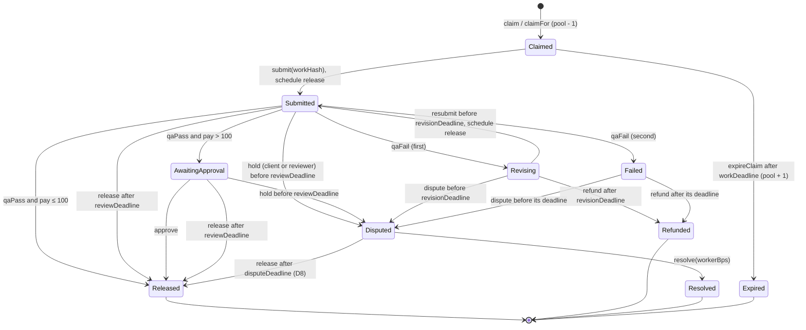

# Byline Work: Build Phases and Requirements

Companion to [BYLINE_WORK.md](BYLINE_WORK.md). The spec says what we are building. This file says in what order, what "done" means at each step, and which gaps in the spec we close before writing code.

Status: implemented. This file was the plan written before code (2026-11-06) and is kept as the design record. ESC-22 (dual review) and X4-06 (`/x402/client/:id/stats`) from the stretch list are now built. See the README for what is verified and how.

---

## Contents

1. [Starting point](#1-starting-point)
2. [Decisions to make before code](#2-decisions-to-make-before-code)
3. [Spec gaps and proposed fixes](#3-spec-gaps-and-proposed-fixes)
4. [Revised escrow state machine](#4-revised-escrow-state-machine)
5. [Phases at a glance](#5-phases-at-a-glance)
6. [Phase details](#6-phase-details)
7. [Requirements](#7-requirements)
8. [Demo scenes mapped to requirements](#8-demo-scenes-mapped-to-requirements)
9. [Prize checklist mapped to requirements](#9-prize-checklist-mapped-to-requirements)
10. [Reuse from v2 and repo layout](#10-reuse-from-v2-and-repo-layout)
11. [Accounts, keys and env](#11-accounts-keys-and-env)
12. [Risks to the plan](#12-risks-to-the-plan)
13. [Three-person split](#13-three-person-split)

---

## 1. Starting point

- **This folder** has only `BYLINE_WORK.md`.
- **v2 code** lives in `../ETHGM/Build`: an npm-workspaces monorepo with a Hono API, a Next 16 web app, `node:sqlite`, `@hiero-ledger/sdk` 2.90.1 and `@x402/hedera` 2.30.0. `../Build` is an older copy without the v2 moderation and review work. `BYLINE_V2.md` is at `../ETHGM/Build/BYLINE_V2.md`, so the relative link in the spec is broken from this folder.
- **Reusable from v2, already working:** World ID OIDC login and step-up with single-use approvals, HCS submit and mirror-node reads, an x402 resource server on `hedera:testnet` (Blocky402 or an in-process facilitator), the x402 payer client, the 0G Private Computer client with TEE verification, the account and topic scripts, and the reviewer-queue UI pattern.
- **New for Byline Work (nothing to reuse):** Solidity (v2 has no contracts), Stablecoin Studio, scheduled releases, HTS token operations (KYC, freeze, custom fees, burn), a contract event indexer, and a keeper.
- **Toolchain:** Node 24.13 is installed. Foundry is not on PATH on this machine. The sibling projects AFTERMATH and BLACKOUT use Foundry, so we install it here too.

Two Hedera facts change the design slightly from the spec:

- **HIP-1215 (generalized scheduled contract calls)** lets a contract schedule its own future call through the Hedera Schedule Service system contract at `0x16b` (`scheduleCall`, shipped in services v0.68, on testnet since late 2025). The escrow can schedule its own release inside `submit`, with no Byline server involved. The spec's backend `ScheduleCreate` becomes the fallback. Confirm in spike S3. ([Hedera Schedule Service docs](https://docs.hedera.com/hedera/core-concepts/smart-contracts/system-smart-contracts/hedera-schedule-service), [HIP-1215](https://deploy-preview-1137--hedera-hips.netlify.app/hip/hip-1215))
- **Stablecoin Studio is now built from facets** (a diamond-style resolver proxy). Token keys sit with the stablecoin's contract, so KYC, freeze, wipe and fee changes go through Stablecoin Studio roles, not raw HTS keys. It has a `CustomFeesFacet`, a demo reserve mode (updated by the admin) or a Chainlink-compatible reserve feed, and a `HoldManagementFacet` that can lock tokens under an escrow address. We don't need holds, but they are a fallback if the ERC-20 facade fights us. ([Stablecoin Studio contracts overview](https://docs.stablecoin-studio.hedera.com/scs/contracts/overview/), [core concepts](https://docs.hedera.com/hedera/open-source-solutions/stablecoin-studio/core-concepts))

---

## 2. Decisions to make before code

| # | Decision | Options | Recommendation | Settled by |
|---|---|---|---|---|
| D1 | How the release gets scheduled | (a) The escrow calls HIP-1215 `scheduleCall` inside `submit`. (b) The backend sends `ScheduleCreateTransaction` wrapping `ContractExecuteTransaction` with `waitForExpiry = true` (HIP-423). (c) A keeper only. | (a) if spike S3 passes, then (b), then (c). **Build the keeper in every case**: it also expires claims, processes refunds and retries failed releases. | Spike S3 |
| D2 | Who sends claim and submit transactions | The freelancer's wallet signs (needs HBAR and wallet connect), or a backend relayer calls `claimFor` / `submitFor` | Relayer, so the freelancer never needs HBAR. Keep direct `claim` / `submit` in the contract for tasks of $100 or less. The freelancer still owns their payout account and can call `release` from HashScan. | Team |
| D3 | Where the lab's key lives in the demo | Server-held demo key, or HashPack / WalletConnect | Server-held, labelled "demo custody" in the UI. Wallet connect is stretch. | Team |
| D4 | Custom fee setup | Tiny fixed HTS fee plus the real 3% inside the contract, or the escrow as an exempt fee collector | Whichever spike S4 shows leaves the escrow's balance exactly as the contract expects | Spike S4 |
| D5 | Redemption path | Freelancer transfers to the treasury, then burn, or wipe from the freelancer's account after a World ID step-up | Transfer then burn if Stablecoin Studio allows it, otherwise wipe | Spike S6 |
| D6 | Repo | New monorepo in this folder porting v2 modules, or a branch of the v2 repo | New monorepo here: no Arkiv, no ask pipeline, and a clean commit history that shows judges what is new | Team |
| D7 | Testing HTS behaviour in Foundry | Mock bUSD as a plain ERC-20 and mock the schedule service with `vm.etch`, or Hedera's Foundry HTS emulation | Mocks for unit tests, plus one real testnet run of every path in Phase 2 | Team |
| D8 | What happens when a dispute isn't resolved in time | Pay the worker, split 50/50, or refund the client | Pay the worker. Principle 2: silence pays the person who did the work, and slow reviewers are the platform's cost. | Team |
| D9 | Platform fee on refunds and splits | Keep the fee, or refund it | Charge the fee only on the amount actually paid to the worker. Refund the rest to the client. | Team |

Record each decision here, with the spike's tx IDs, before Phase 1 starts.

---

## 3. Spec gaps and proposed fixes

| # | Gap in BYLINE_WORK.md | Why it matters | Proposed fix |
|---|---|---|---|
| 1 | `Claimed → Open` on a missed work deadline has no function | Tasks stay claimed forever | Add `expireClaim(taskId)`, callable by anyone after `workDeadline`. The keeper calls it. |
| 2 | A second `qaFail` leads to `Refunded` "if no dispute", but there is no state in which the worker can dispute | The worker can't contest a second failure | Add a `Failed` state with a dispute window equal to `revisionWindow`. `refund` only after it closes. |
| 3 | The revision deadline arithmetic isn't defined | If a resubmit restarts the 72-hour clock, "never more than 4 days" breaks | On resubmit: `reviewDeadline = firstSubmittedAt + reviewWindow + revisionWindow`. Schedule a new release for that time. |
| 4 | `Disputed` has no deadline | Breaks principle 2, and lets a reviewer stall | Add `DISPUTE_WINDOW` (7 days, 10 minutes in the demo build). After it, `release` follows D8. |
| 5 | A client can't recover money for unclaimed tasks | Funds sit in a dead batch forever | Add `withdrawUnclaimed(batchId, count)`. The client can pull unclaimed tasks at any time. Claimed tasks are untouchable. |
| 6 | The fee on refunds and splits isn't defined | Accounting and invariant tests depend on it | D9 |
| 7 | `fundBatch` has one `payPerTask`, but the demo funds $40 and $250 tasks in one batch | The demo script contradicts the interface | Two batches in the demo seed |
| 8 | The World ID step-up for claims over $100 happens off-chain, but `claim` is public | Anyone can skip the step-up by calling the contract directly | Direct `claim` reverts above `HITL_THRESHOLD`. Those tasks can only be claimed through `claimFor`, and the relayer checks the step-up approval first. |
| 9 | Releasing to a frozen or un-KYC'd worker, or while bUSD is paused, reverts | The scheduled release is used up and fails, so "silence pays" stalls | `release` reverts cleanly with state unchanged, and the keeper retries. The README says that timeouts resume once the account or token is unfrozen. On confirmed fraud a reviewer resolves the task as a refund. |
| 10 | What happens to in-flight pay when a worker changes payout wallet | A takeover of a rented account could redirect pay already earned | The payout address is fixed at claim time. A wallet change only applies to new claims. |
| 11 | The timeout demo needs QA that doesn't run | Auto QA would pass the task within minutes | Per-batch `qaMode: auto | manual`, stored off-chain. The timeout batch is manual. |
| 12 | Contributor Score constants `k` and the dispute penalty aren't given | The score can't be computed | Start with `k = 200` bUSD and 10 points per dispute lost, floor 0. Tune on seed data. |
| 13 | Reviewer as "a Hedera account with a threshold key" | On the EVM, `msg.sender` is one address, and a threshold key doesn't map to one ECDSA signer | Demo: one ECDSA reviewer. The dual-review tier (stretch) uses two reviewer addresses on-chain. |
| 14 | HCS "no personal data", but messages carry account IDs | Account IDs are pseudonymous but link to payouts | Keep them, since they're already public in the token transfers. Never write a World `sub`. Say so in the README. |
| 15 | Repo layout in spec section 13 has `api/` at the root "extending the v2 server" | v2 is a workspace monorepo | Use the v2 layout (see [section 10](#10-reuse-from-v2-and-repo-layout)) |

---

## 4. Revised escrow state machine

This is the spec's machine with gaps 1 to 5 closed. Batches hold a pool of unclaimed tasks. A task record exists from claim onwards.



**Money per task.** The client funds `pay + fee`, where `fee = pay × 300 / 10000`.

| End state | Worker | Client | Treasury + QA pool |
|---|---|---|---|
| Released | `pay` | 0 | `fee`, split by `qaPoolShareBps` |
| Refunded | 0 | `pay + fee` | 0 |
| Resolved | `pay × workerBps` | the rest of `pay`, plus the unused fee | `fee × workerBps` |

Rounding dust goes to the treasury. The sum always equals `pay + fee`.

---

## 5. Phases at a glance

| Phase | Goal | Estimate | Exit gate | Needs |
|---|---|---|---|---|
| **0** | Spikes, setup, bUSD live on testnet | 3–4 h | G0 | — |
| **1** | `EscrowVault.sol`: every transition tested, deployed, verified | 5–6 h | G1 | 0 |
| **2** | Backend rails: indexer, HCS log, QA oracle, keeper, headless end-to-end on testnet | 4–5 h | G2 | 1 |
| **3** | Web app: lab, work, review, transparency | 4–5 h | G3 | 2 |
| **4** | x402 data service and issuer lifecycle (deposit, KYC, freeze, redeem) | 3 h | G4 | 0, 2 (can run alongside 3) |
| **5** | Contributor Score, training receipt, 0G grader, mock off-ramp | 3–4 h | G5 | 2 |
| **6** | Demo hardening, README, video, submission | 3 h | G6 | 3, 4 |
| Stretch | Dual review, client stats, wallet connect, peer QA, Stablecoin Studio contribution | — | — | — |

**Cut line: after G4 the project meets every prize requirement.** Phase 5 adds extra points and story. Total is about 25 to 30 hours.

**With 3 people:** see [section 13](#13-three-person-split). Contracts run alongside the API scaffold, the World ID port and the x402 skeleton, and alongside a web skeleton against a mocked API. Wall clock to the prize cut line (G4) is about 12 hours, and to a recorded demo (G6) about 15, if the chain track does not slip.

---

## 6. Phase details

### Phase 0: Spikes and setup

**Spikes.** Each answers one question on testnet. Write the answer and tx IDs into [section 2](#2-decisions-to-make-before-code).

| # | Question | How to test | Pass | If it fails |
|---|---|---|---|---|
| S1 | Can we create bUSD with Stablecoin Studio (KYC, freeze, wipe, pause, custom fee, demo reserve), and which SDK version works? | SDK script, or the Stablecoin Studio web app | Token on HashScan with the keys set; a cash-in above the reserve fails | Create it in the web app, use the SDK only for lifecycle calls |
| S2 | Can a contract hold bUSD? Association (HIP-719 or the HTS system contract), KYC through Stablecoin Studio, `transferFrom` through the ERC-20 facade after an HTS allowance | A tiny test contract | Fund in and pay out both succeed | HTS system contract `transferToken`, or Stablecoin Studio holds |
| S3 | Can a contract schedule its own call with HIP-1215 `scheduleCall`? Does it run on time, what does it cost, and what happens if the target reverts? | Test contract schedules `ping()` 60 s out | Execution shows on HashScan at expiry | S3b |
| S3b | Only if S3 fails: does `ScheduleCreate` wrapping `ContractExecute` with `waitForExpiry` work? | SDK script | Same | Keeper only |
| S4 | How does the custom fee hit transfers made by a contract? Who pays, and are collectors exempt? | Transfer into and out of the S2 contract with the fee set | Escrow balance after payout is exactly what the contract expects | Real fee inside the contract only, HTS fee only off the escrow path |
| S5 | What happens on a transfer to a frozen account and to an un-KYC'd account through the facade? | Freeze a test account, try a payout | Clean revert, no state change | — |
| S6 | Can a worker send bUSD to the Stablecoin Studio treasury for burning, or do we wipe? | SDK | Burn plus reserve update on HashScan | Wipe after a World ID step-up |
| S7 | Is a `hedera:testnet` x402 facilitator still up? | v2 `npm run pay-once` | Settled tx | `X402_FACILITATOR_URL=local` |
| S8 | Does the World ID client work with the new redirect URI, and is `acr` present? | v2 login and step-up | Both succeed | — |

**Setup.** Install Foundry. Scaffold the monorepo ([section 10](#10-reuse-from-v2-and-repo-layout)). Generate keys, create accounts ([section 11](#11-accounts-keys-and-env)) and the HCS topic. Create bUSD. Register the World ID client.

**G0:** D1, D4 and D5 are recorded with tx IDs. bUSD is on HashScan with KYC, freeze, pause, wipe, fee and reserve. `npm run typecheck` and `forge build` pass on the empty scaffold.

### Phase 1: Escrow contract

Requirements: all of ESC, plus SCH-01, SCH-02 and SCH-04 on the contract side.

1. Storage: batches (client, pay, windows, unclaimed count, fee owed), tasks (state, worker, payout address, deadlines, hashes, fail count, schedule address).
2. Roles: `ADMIN`, `VERIFIER`, `RELAYER`, `QA_ORACLE`, `REVIEWER`. Worker registry with status and in-flight cap.
3. Every function in [section 4](#4-revised-escrow-state-machine), with one event per transition.
4. HIP-1215 scheduling behind a constructor flag, so the same code deploys with or without it.
5. Tests, one per path: instant; approved; timeout from `Submitted`; timeout from `AwaitingApproval`; revise then pass; revise then no resubmit then refund; fail twice then refund; fail twice then dispute then resolve; client hold then resolve; dispute timeout (D8); `expireClaim`; `withdrawUnclaimed`; direct claim above $100 reverts; release to a frozen worker reverts with state unchanged (mock); fee split and rounding. Fuzz and invariant tests for ESC-20.
6. Deploy script, verify on HashScan, then a setup step: associate bUSD, grant KYC to the escrow, send HBAR for schedule fees.

**G1:** all tests green, every transition covered. Deployed and verified on HashScan. One instant-path run on testnet with real bUSD from a script, with the tx on HashScan.

### Phase 2: Backend rails

Requirements: API-01 to API-07, QA-01 to QA-03, SCH-03, ID-01 to ID-03, ID-06, ID-07, NFR-05.

1. Port config, DB, World ID and HCS from v2. New tables: workers, batches, tasks, task_events, work (private), reports, approvals, denials.
2. Escrow client: encode calls with viem, send them as `ContractExecuteTransaction` from each role account.
3. Indexer: poll mirror-node contract logs, decode, upsert by `(txHash, logIndex)`, and write one HCS message per event.
4. QA oracle with gold questions and a rubric checklist. Keeper.
5. `scripts/e2e.ts`: runs the instant, approved and timeout paths headless on testnet.

**G2:** `npm run e2e` passes on testnet. Each path ends with the worker's bUSD up by `pay`, the treasury and QA pool up by the fee split, and an HCS message for every transition. The timeout path shows its schedule on HashScan. Turning scheduling off proves the keeper path pays too.

### Phase 3: Web app

Requirements: WEB-01 to WEB-06, API-09.

`/lab`, `/work`, `/review` and `/transparency`, each with HashScan links on every money action and a live countdown on submitted tasks.

**G3:** demo scenes 0:55 to 3:00 run by clicking, with no terminal.

### Phase 4: x402 data service and issuer lifecycle

Requirements: X4-01 to X4-05, X4-07 to X4-09, TOK-06, TOK-07, TOK-09, ID-05.

1. Paid routes on the v2 x402 server setup, priced in tinybars. Signed responses.
2. `stablecoin/lifecycle.ts` with `deposit`, `kyc`, `freeze`, `unfreeze`, `pause`, `redeem`.
3. The work page shows ₹ value from the FX feed, bought over x402 by the backend's agent account.
4. `scripts/buy-nav.ts`: an outside agent pays, then checks the signature and the HCS anchor.

**G4:** `buy-nav` pays 0.001 HBAR and verifies. The worker wallet shows ₹. The freeze scene and the redemption scene both reproduce. **This is the cut line.**

### Phase 5: Score, receipts, grader, off-ramp

Requirements: SCR-01 to SCR-04, QA-04, OFF-01, OFF-02, X4-06 if time.

**G5:** `npm run score`, reading only the mirror node, matches the leaderboard. A completed batch writes a training licence receipt to HCS. A 0G grader report shows `teeVerified: true`. Redemption shows "₹ credited (simulated)".

### Phase 6: Demo, docs, submission

Requirements: DEMO and DOC.

**G6:** the full demo runs three times in a row from a fresh seed. The README lists every ID and address with HashScan links. The video is under 5 minutes. Submitted.

---

## 7. Requirements

Priority: **M** = must (spec P0, a prize requirement, or a demo scene depends on it), **S** = should (spec P1/P2, extra points or story), **C** = could (stretch).

### TOK: the stablecoin (Stablecoin Studio)

| ID | Requirement | Acceptance | Pri | Phase |
|---|---|---|---|---|
| TOK-01 | Create bUSD with Stablecoin Studio: 6 decimals, supply 0, KYC, freeze, wipe, pause and fee schedule handled by Stablecoin Studio roles | Token ID and proxy on HashScan. `stablecoin/create-busd.ts` prints the env lines. | M | 0 |
| TOK-02 | Reserve in demo mode. Cash-in can't push supply above the reserve. | A cash-in above the reserve fails, tx recorded | M | 0 |
| TOK-03 | Roles on separate accounts: cash-in, burn, KYC, freeze, pause, fees | Each lifecycle operation in the demo is signed by its own role account | S | 0 |
| TOK-04 | Custom fee configured per D4 | Fee shows on the token and is charged on a demo transfer. Escrow accounting unaffected. | M | 0 |
| TOK-05 | KYC granted to the escrow, treasury, QA pool, lab, and each worker after World ID and payout binding | A transfer to an un-KYC'd account fails | M | 0, 2 |
| TOK-06 | Deposit: reserve update, then cash-in to the lab | `lifecycle.ts deposit <lab> <amount>` produces both txs | M | 4 |
| TOK-07 | Freeze and unfreeze a worker account | A transfer from the frozen account fails on HashScan | M | 4 |
| TOK-08 | Pause and unpause the token (admin only, not in the demo) | Works, and its effect on releases is documented | C | 4 |
| TOK-09 | Redemption per D5: burn plus reserve decrease | Supply and reserve both drop by the amount | S | 4 |
| TOK-10 | The escrow is token-agnostic: the token address is a constructor argument | Tests run against the mock token, testnet against bUSD | M | 1 |

### ESC: EscrowVault.sol

| ID | Requirement | Acceptance | Pri | Phase |
|---|---|---|---|---|
| ESC-01 | `fundBatch` pulls `taskCount × (pay + fee)` with `transferFrom`. Windows are bounded `[minWindow, max]`, with `minWindow = 120 s` in the testnet build. | Short allowance reverts. Funded batch emits its total. | M | 1 |
| ESC-02 | `claim` / `claimFor`: worker registered and active, payout address stored at claim, direct `claim` reverts above `HITL_THRESHOLD`, in-flight cap per worker | Tests for each revert | M | 1 |
| ESC-03 | `expireClaim` after `workDeadline`, callable by anyone, returns the task to the pool | Test | M | 1 |
| ESC-04 | `submit` / `submitFor(workHash)` sets `reviewDeadline` and schedules the release (D1). The event carries the schedule address. | Test plus testnet schedule on HashScan | M | 1 |
| ESC-05 | `qaPass`: $100 or less pays in the same tx, over $100 moves to `AwaitingApproval` | Tests | M | 1 |
| ESC-06 | `qaFail`: first moves to `Revising`, second moves to `Failed` | Tests | M | 1 |
| ESC-07 | Resubmit from `Revising` uses the deadline cap from gap 3 and schedules a new release | Test: total never over `reviewWindow + revisionWindow` | M | 1 |
| ESC-08 | `approve` by `REVIEWER` pays from `AwaitingApproval` | Test | M | 1 |
| ESC-09 | `hold(reasonHash)` by a reviewer or the batch's client, from `Submitted` or `AwaitingApproval`, before the deadline, moves to `Disputed` | Tests, including hold after deadline reverts | M | 1 |
| ESC-10 | `dispute(reasonHash)` by the worker from `Revising` or `Failed` before the deadline | Test | S | 1 |
| ESC-11 | `resolve(workerBps)` by `REVIEWER` splits per [section 4](#4-revised-escrow-state-machine) | Fuzzed conservation test | M | 1 |
| ESC-12 | `release` callable by anyone: after `reviewDeadline` from `Submitted` or `AwaitingApproval`, after `disputeDeadline` from `Disputed` (D8). `releaseIfDue` never reverts and is the schedule's target. | Tests | M | 1 |
| ESC-13 | `refund` callable by anyone, paid to the client: `Revising` after `revisionDeadline`, `Failed` after its deadline | Tests | M | 1 |
| ESC-14 | `withdrawUnclaimed(batchId, count)` by the client | Test: claimed tasks unaffected | S | 1 |
| ESC-15 | Fee split on payout between treasury and QA pool by `qaPoolShareBps`, dust to treasury | Test | M | 1 |
| ESC-16 | Roles as in Phase 1. Admin can pause new batches and claims only. Nothing can move locked funds. Not upgradeable. | Tests that admin can't touch a locked task | M | 1 |
| ESC-17 | One event per transition with task ID, batch ID, amounts and hashes | Indexer decodes every event | M | 1 |
| ESC-18 | Associates with bUSD at deploy. Holds HBAR for schedule fees (`receive()`). | Setup tx on HashScan | M | 1 |
| ESC-19 | Reentrancy guard, checks-effects-interactions, transfer results checked. A failed transfer reverts the whole call. | Frozen-worker mock test | M | 1 |
| ESC-20 | Invariants: token balance ≥ unclaimed + locked + fees owed; each task reaches a terminal state once; per-task conservation | Foundry invariant tests | M | 1 |
| ESC-21 | Verified on HashScan | Link in README | M | 1 |
| ESC-22 | Two reviewers above $1,000 | Test | C | Stretch |

### SCH: scheduled release

| ID | Requirement | Acceptance | Pri | Phase |
|---|---|---|---|---|
| SCH-01 | A release is scheduled at `reviewDeadline` on every submit and resubmit (D1) | Schedule on HashScan for each submit | M | 1, 2 |
| SCH-02 | The schedule calls `releaseIfDue`, which is a no-op if the task isn't due or is already final | A schedule firing after `qaPass` shows success, no transfer | M | 1 |
| SCH-03 | Keeper every 15 s: due releases, expired claims, refunds, dispute timeouts. Retries failed releases. Idempotent. | With scheduling off, the timeout path still pays | M | 2 |
| SCH-04 | Schedule capacity and fees: check `hasScheduleCapacity`, retry the next second, alert when the escrow's HBAR is low | Log line on low balance | S | 1, 2 |
| SCH-05 | UI and HCS messages carry the schedule ID with a HashScan link | Visible in the timeout scene | M | 2, 3 |

### ID: identity and accounts

| ID | Requirement | Acceptance | Pri | Phase |
|---|---|---|---|---|
| ID-01 | World ID login ported from v2. One worker per `(iss, sub)`. | Second login with the same World ID lands on the same worker | M | 2 |
| ID-02 | Payout account binding behind a step-up: account exists on the mirror node and can hold bUSD, then KYC grant and `registerWorker` on-chain | KYC and registration txs on HashScan | M | 2 |
| ID-03 | Step-up actions `claim_high` (target: batch) and `payout_wallet`. Single-use approvals with a TTL. | Replay and wrong-target denials work as in v2 | M | 2 |
| ID-04 | Daily claim cap per World ID, in-flight cap for new accounts | Denial shown at the cap | S | 2 |
| ID-05 | Fraud action: freeze the token account, `setWorkerStatus(suspended)`, HCS message, ban the World ID | Freeze scene | M | 4 |
| ID-06 | Lab accounts (mock KYB allowlist) and reviewers (allowlist) gated in the app | Non-lab can't open `/lab` actions | M | 2 |
| ID-07 | World `sub` never leaves the database | Grep of HCS messages and events | M | 2 |

### API: backend

| ID | Requirement | Acceptance | Pri | Phase |
|---|---|---|---|---|
| API-01 | Monorepo scaffold per [section 10](#10-reuse-from-v2-and-repo-layout) | `npm run typecheck` passes | M | 0 |
| API-02 | Escrow client: viem encoding, `ContractExecuteTransaction` from role accounts, readable revert reasons | Revert reason shown in UI | M | 2 |
| API-03 | Batch API: create (title, rubric, tasks, gold answers kept private, `qaMode`), then allowance and `fundBatch` with the lab's key (D3) | "Funded: $X locked" with HashScan link | M | 2 |
| API-04 | Task API: feed of funded unclaimed tasks, claim (relayer, step-up above $100), submit (store work, `sha256`, relay) | Work body never leaves the DB | M | 2 |
| API-05 | Indexer: mirror-node contract logs every ~3 s, decoded, upserted by `(txHash, logIndex)`. Catches events from any sender, including schedules and HashScan calls. | A release sent from HashScan shows in the app | M | 2 |
| API-06 | HCS task log: one v3 message per event, under 1024 bytes, retried on failure, sequence stored | Topic on HashScan has a message per transition | M | 2 |
| API-07 | Reviewer API: queue, approve, hold (reason text stored, hash on-chain), resolve | Review scene | M | 2 |
| API-08 | Features with missing env answer 503 with a clear message (v2 pattern) | Boots with partial env | S | 2 |
| API-09 | Live task state and countdown (SSE or polling) | Countdown ticks without reload | S | 3 |

### QA

| ID | Requirement | Acceptance | Pri | Phase |
|---|---|---|---|---|
| QA-01 | Oracle loop: grades an auto-QA submission within 2 minutes, then `qaPass` or `qaFail` with `reportHash`. Report stored. | Instant scene pays within the scene's 30 s | M | 2 |
| QA-02 | Checks: gold questions and a rubric checklist (deterministic) | Wrong gold answer fails the task | M | 2 |
| QA-03 | `qaMode` per batch: `auto` or `manual` | Manual batch reaches the timeout | M | 2 |
| QA-04 | 0G TEE rubric grader (`zgChat`, JSON, private trust mode). Report records `requestId` and `teeVerified`. | Report shows `teeVerified: true` | S | 5 |
| QA-05 | Run tests for code tasks in a sandbox | — | C | Stretch |
| QA-06 | Sampled peer review | — | C | Stretch |

### X4: x402 data service

| ID | Requirement | Acceptance | Pri | Phase |
|---|---|---|---|---|
| X4-01 | x402 resource server reused from v2 (facilitator, local mode), prices in tinybars | Unpaid call returns 402 with price | M | 4 |
| X4-02 | `GET /x402/busd/reserve`: supply (mirror node), reserve, ratio, last update tx | Paid call returns all four | M | 4 |
| X4-03 | `GET /x402/busd/nav`: reserve ÷ supply, with history | Shows 1.00 and the history | M | 4 |
| X4-04 | `GET /x402/fx/:pair`: USD-INR, USD-PHP, USD-NGN with source and timestamp, cached 60 s, labelled as a public FX source | Work page shows ₹ | S | 4 |
| X4-05 | `GET /x402/escrow/stats`: value locked, tasks by state, median time to pay, auto-release share, dispute rate | Numbers match the DB | S | 4 |
| X4-06 | `GET /x402/client/:id/stats` | — | C | 5 |
| X4-07 | Every response signed (EIP-191, feed key, v2 attestation pattern). Response hash anchored on HCS (`kind: "feed"`). | `buy-nav` verifies both | M (signing), S (anchor) | 4 |
| X4-08 | The backend buys FX over x402 with its agent account and caches it | Payments visible on HashScan | S | 4 |
| X4-09 | `scripts/buy-nav.ts`: an outside agent pays and verifies | Transparency scene | M | 4 |

### OFF: off-ramp

| ID | Requirement | Acceptance | Pri | Phase |
|---|---|---|---|---|
| OFF-01 | `OffRampProvider` interface and `MockOffRamp`, labelled simulated, quote from the FX feed | Unit test | S | 5 |
| OFF-02 | Redeem UI: amount, quote, burn tx, "₹ credited (simulated)" | Redemption scene | S | 5 |

### SCR: score and receipts

| ID | Requirement | Acceptance | Pri | Phase |
|---|---|---|---|---|
| SCR-01 | Contributor Score as a pure function in `packages/shared`, constants in one place (gap 12) | Unit tests | S | 5 |
| SCR-02 | `npm run score` reads only the HCS topic from the mirror node | Matches the leaderboard | S | 5 |
| SCR-03 | Leaderboard on `/transparency` | Transparency scene | S | 5 |
| SCR-04 | Training licence receipt on batch completion (`kind: "receipt"`: task hashes, verified-human count, total paid, terms hash) | Message on HashScan | S | 5 |
| SCR-05 | Score tiers set the in-flight cap | — | C | Stretch |

### WEB

| ID | Requirement | Acceptance | Pri | Phase |
|---|---|---|---|---|
| WEB-01 | `/lab`: create and fund batches, batch status table | Scene 0:55 | M | 3 |
| WEB-02 | `/work`: World ID sign-in, payout binding, task feed, claim, submit, task timeline, wallet in bUSD and ₹ | Scenes 1:30 to 3:00 | M | 3 |
| WEB-03 | `/review`: approve, hold with reason, resolve with split | Scene 2:30 | M | 3 |
| WEB-04 | `/transparency`: reserve, NAV, supply, value locked, live HCS log. Leaderboard (S). | Scene 4:20 | M | 3 |
| WEB-05 | Every money action links to HashScan: tx, schedule, topic message, token, contract | Click-through in every scene | M | 3 |
| WEB-06 | Countdown to `reviewDeadline` and a state badge per task | Scene 3:00 | M | 3 |
| WEB-07 | Issuer console in the app (otherwise use the Stablecoin Studio web app plus scripts) | — | C | Stretch |
| WEB-08 | Wallet connect (HashPack) for labs and workers | — | C | Stretch |

### DEMO and DOC

| ID | Requirement | Acceptance | Pri | Phase |
|---|---|---|---|---|
| DEMO-01 | `scripts/demo-seed.ts`: lab deposit of 1,000; batch A 10 × $40 auto; batch B 1 × $250 auto; batch C 1 × $40 manual with a 120 s window; claims and submits the timeout task about 2 minutes before its scene; sets up the rented account | One command prepares a take | M | 6 |
| DEMO-02 | New batch IDs per take, no redeploy | Three takes in a row | M | 6 |
| DEMO-03 | Backup recordings for the World ID scan and x402 settlement | Clips on disk | S | 6 |
| DOC-01 | README: what and why, run steps, every ID and address with HashScan links, verified contract link, reused v2 modules disclosed | — | M | 6 |
| DOC-02 | Architecture diagram | — | M | 6 |
| DOC-03 | Demo video under 5 minutes | — | M | 6 |
| DOC-04 | "What we do not claim" and limitations, including gap 9 | — | M | 6 |
| DOC-05 | Issue or PR to Stablecoin Studio ("escrow with scheduled release" example or a docs fix) | Link | C | Stretch |

### NFR: cross-cutting

| ID | Requirement | Pri |
|---|---|---|
| NFR-01 | Testnet only. `.env` never committed. Demo custody keys labelled in the UI. | M |
| NFR-02 | No personal data on-chain or on HCS. Work content off-chain, only hashes on-chain. | M |
| NFR-03 | Money as `bigint`: bUSD at 6 decimals, HBAR in tinybars. No floats on money paths. | M |
| NFR-04 | Payout visible in the UI within 10 s of consensus | S |
| NFR-05 | Indexer, keeper and oracle are restart-safe and idempotent | M |
| NFR-06 | Foundry tests for every transition. `tsx --test` for score, fee math, HCS schema and units. | M |

---

## 8. Demo scenes mapped to requirements

| Time | Scene | Requirements |
|---|---|---|
| 0:25 | Issuance | TOK-01 to TOK-04 |
| 0:55 | Lab deposits and funds | TOK-02, TOK-06, ESC-01, API-03, WEB-01, DEMO-01 |
| 1:30 | Freelancer joins | ID-01, ID-02, TOK-05, X4-04, X4-08, WEB-02 |
| 2:00 | $40 instant | ESC-02, ESC-04, ESC-05, QA-01, QA-02, API-04 to API-06, WEB-05 |
| 2:30 | $250 with reviewer | ESC-05, ESC-08, ID-03, API-07, WEB-03 |
| 3:00 | Timeout | SCH-01, SCH-02, SCH-05, ESC-12, QA-03, WEB-06, DEMO-01 |
| 3:35 | Fraud freeze | TOK-07, ID-05 |
| 3:55 | Redemption | TOK-09, OFF-01, OFF-02 |
| 4:20 | Transparency | X4-02, X4-03, X4-07, X4-09, SCR-03, WEB-04 |

---

## 9. Prize checklist mapped to requirements

| Prize requirement | Requirements | Gate |
|---|---|---|
| Issue or manage a stablecoin with Stablecoin Studio | TOK-01 to TOK-09 | G0, G4 |
| Deploy and demo on testnet | All | G6 |
| Public repo, contracts verified on HashScan | ESC-21, DOC-01 | G1, G6 |
| Video under 5 min: issuance, configuration, a lifecycle operation | DOC-03, DEMO-01 | G6 |
| x402 service selling data about the token | X4-01 to X4-03, X4-09 | G4 |
| Extra: compliance controls | TOK-05, TOK-07, TOK-08, ID-05 | G4 |
| Extra: custom fees and distributions | TOK-04, ESC-15 | G0, G1 |
| Extra: oracle pricing or NAV feeds | TOK-02, X4-02 to X4-04 | G4 |
| Extra: Scheduled Transactions | SCH-01 to SCH-05 | G2 |
| Extra: contribution back to Stablecoin Studio | DOC-05 | Stretch |

---

## 10. Reuse from v2 and repo layout

| v2 file (`../ETHGM/Build`) | New home | Change |
|---|---|---|
| `apps/api/src/world.ts` | `apps/api/src/world.ts` | Writer becomes worker. Step-up actions `claim_high`, `payout_wallet`. |
| `apps/api/src/hcs.ts` | `apps/api/src/hcs.ts` | Generic `submitMessage`. v3 message types `task`, `feed`, `receipt`. Reader filters `v: 3`. |
| `apps/api/src/payments.ts` | `apps/api/src/oracle/x402.ts` | Keep the facilitator and resource server setup. Static per-route HBAR prices. Drop article and cite logic. |
| `packages/agent/src/payer.ts` | `packages/shared/src/x402-payer.ts` | x402 client for the FX feed and `buy-nav` |
| `packages/agent/src/zg.ts` | `apps/api/src/qa/zg.ts` | As is |
| `packages/shared/src/attestation.ts` | `packages/shared/src/feed-sig.ts` | Canonical feed statement, EIP-191 sign and verify |
| `packages/shared/src/hedera.ts` | Same | Add HashScan links for contract, schedule and token |
| `packages/shared/src/units.ts` | Same | bUSD at 6 decimals, tinybars |
| `apps/api/src/moderation.ts` | `apps/api/src/caps.ts` | Daily caps, strikes and bans per World ID |
| `apps/api/src/config.ts`, `db.ts` | Same | Same pattern, new tables |
| `apps/web/app/review/page.tsx` | Same | Queue layout, new actions |
| `apps/web/components/*`, `lib/api.ts`, `lib/format.ts` | Same | Minor |
| `scripts/gen-keys.ts`, `lib.ts`, `create-accounts.ts`, `create-topic.ts`, `pay-once.ts` | `scripts/` | New account plan. `pay-once` becomes `buy-nav`. |
| Dropped | — | Arkiv (`arkiv*.ts`, `listing.ts`), ask pipeline, budget, citations, authenticity |

```
Build V2/                     # repo root
  BYLINE_WORK.md
  BYLINE_WORK_BUILD.md
  package.json                # npm workspaces, tsx, typescript (v2 versions)
  contracts/                  # Foundry
    src/EscrowVault.sol
    src/hedera/               # schedule service, token service, HIP-719 interfaces
    test/                     # path tests, invariants, MockBUSD, MockScheduleService
    script/Deploy.s.sol
  stablecoin/
    create-busd.ts
    lifecycle.ts              # deposit, kyc, freeze, unfreeze, pause, redeem
  packages/shared/src/        # types, units, HashScan links, HCS schemas, score, feed-sig, escrow ABI
  apps/api/src/
    config.ts db.ts world.ts caps.ts hcs.ts
    escrow.ts                 # contract calls
    indexer.ts keeper.ts
    schedule.ts               # only if D1 falls back to (b)
    qa/ oracle/ offramp/ score.ts
  apps/web/app/               # lab, work, review, transparency
  scripts/                    # gen-keys, create-accounts, create-topic, demo-seed, e2e, buy-nav, score
```

---

## 11. Accounts, keys and env

All new accounts use ECDSA keys, so their EVM address is the `msg.sender` the contract sees and Foundry can deploy through the JSON-RPC relay.

| Account | Purpose | HBAR to start |
|---|---|---|
| `OPERATOR` | Pays setup, holds the HCS submit key (existing, from portal.hedera.com) | Portal |
| `SCS_ADMIN` | Stablecoin Studio admin, grants roles | 50 |
| `CASHIN` | Cash-in role | 5 |
| `BURN` | Burn and wipe roles | 5 |
| `COMPLIANCE` | KYC and freeze roles (split them if time allows) | 5 |
| `TREASURY` | Fee collector and redemption target | 2 |
| `QA_POOL` | QA reviewers' share of the fee | 1 |
| `ESCROW_ADMIN` | Deploys the escrow, holds `ADMIN` | 50 |
| `BACKEND` | `VERIFIER` and `RELAYER`, runs the keeper | 30 |
| `QA_ORACLE` | `qaPass`, `qaFail` | 10 |
| `REVIEWER` | `approve`, `hold`, `resolve` | 5 |
| `LAB` | The client, demo custody | 10 |
| `WORKER_A` (Pune), `WORKER_B`, `WORKER_RENTED` | Payees, auto-association on | 1 each |
| `AGENT` | x402 buyer for FX and `buy-nav` | 20 |
| Escrow contract | Pays HIP-1215 schedule fees | 20 |

**New env on top of v2's** (`HEDERA_*`, `OPERATOR_*`, `HCS_TOPIC_ID`, `X402_*`, `ZG_*`, `WORLD_*` carry over; `ARKIV_*` is dropped):

```
HEDERA_JSON_RPC=https://testnet.hashio.io/api
BUSD_TOKEN_ID=0.0.x
BUSD_SCS_PROXY=0x...            # Stablecoin Studio proxy for this coin
BUSD_RESERVE_ADDRESS=0x...
ESCROW_CONTRACT_ID=0.0.x
ESCROW_ADDRESS=0x...
ESCROW_SCHEDULING=hip1215       # hip1215 | sdk | keeper (D1)
HITL_THRESHOLD=100
DUAL_REVIEW_THRESHOLD=1000
PLATFORM_FEE_BPS=300
QA_POOL_SHARE_BPS=3333
MIN_WINDOW_SEC=120
DISPUTE_WINDOW_SEC=600          # 604800 outside the demo
KEEPER_INTERVAL_SEC=15
FEED_SIGNER_KEY=0x...
FX_API_URL=...                  # public FX source, labelled in responses
PRICE_RESERVE_TINYBAR=100000    # 0.001 HBAR
PRICE_STATS_TINYBAR=500000      # 0.005 HBAR
# plus <ROLE>_ACCOUNT_ID / <ROLE>_PRIVATE_KEY for every account above
```

---

## 12. Risks to the plan

| Risk | Effect | Mitigation |
|---|---|---|
| Contract-scheduled calls don't work as expected on testnet | No on-chain auto-release | D1 fallbacks. The keeper is built anyway, and `release` is permissionless, so the guarantee holds. |
| Stablecoin Studio SDK churn, or the facet architecture slows us down | Phase 0 overruns | Create the token in the web app and use the SDK only for lifecycle calls. Timebox S1 to 90 minutes. |
| ERC-20 facade, KYC and custom fee interactions | Escrow balance drifts or transfers fail | Spikes S2 and S4 in the first hours. Invariant tests. Holds facet as a last resort. |
| Foundry can't run HTS natively | Tests pass, testnet fails | Mocks for unit tests, plus one testnet run of every path in G2 |
| Phase 1 runs long | Everything after slips | Cap at 6 hours. Drop ESC-10, ESC-14 and ESC-22 first. Fold dispute defaults into the keeper if needed. |
| World ID verification flaky on camera | Scene 1:30 fails | Pre-recorded clip (DEMO-03). Fill in the TODOs in v2's `docs/WORLD_DEBRIEF.md` while building. |
| x402 facilitator down | Scene 4:20 fails | `X402_FACILITATOR_URL=local` (v2 already supports it) |
| Public FX API rate limits | ₹ value missing | 60 s cache, last value shown with its timestamp |
| ETHGlobal rules on code written before the event | Reused v2 modules questioned | Check the rules before the event. List reused modules in the README. Commit history shows what is new. |

---

## 13. Three-person split

Lock these in the first 15 minutes and do not reopen them. They are the recommendations already in [section 2](#2-decisions-to-make-before-code).

| Decision | Locked choice |
|---|---|
| D2 | Relayer calls `claimFor` / `submitFor`. Direct `claim` / `submit` stay in the contract for tasks of $100 or less. |
| D3 | Server-held lab key, labelled "demo custody" in the UI. |
| D6 | New monorepo in this folder. |
| D7 | Mock bUSD and `vm.etch` for the schedule service in unit tests. One real testnet run of every path in Phase 2. |
| D8 | An unresolved dispute pays the worker. |
| D9 | Fee only on the amount paid to the worker. The rest of `pay + fee` goes back to the client. |

D1, D4 and D5 stay open until spikes S3, S4 and S6. Person A writes the tx IDs into section 2 the moment each spike finishes. Everyone else codes against the recommendation until that note lands: HIP-1215 inside `submit`, fee math that leaves the escrow balance exact, transfer-then-burn for redemption.

### Who owns what

| | **A. Chain** | **B. Backend** | **C. Product** |
|---|---|---|---|
| Outcome | bUSD live, escrow verified, scheduled release works | Headless testnet paths pay the worker | Clickable demo and the x402 prize route |
| Gates | G0, G1, lifecycle half of G4 | G2 | G3, x402 half of G4, G5 if time, G6 |
| Writes | `contracts/**`, `stablecoin/**`, `packages/shared/src/escrow-abi.ts` | `apps/api/**` except `oracle/` and `offramp/`, `scripts/gen-keys.ts`, `create-accounts.ts`, `create-topic.ts`, `e2e.ts`, root `package.json`, `apps/api` schema in `db.ts`, `.env.example` | `apps/web/**`, `apps/api/src/oracle/**`, `apps/api/src/offramp/**`, `packages/shared/src/{api-types,feed-sig,x402-payer,score,units,hedera}.ts`, `scripts/{buy-nav,score,demo-seed}.ts`, `README.md` |
| Does not touch | Web, keeper, x402 routes | Solidity, Stablecoin Studio lifecycle | Escrow logic, indexer, World ID |

One writer per file. A and C send env lines to B, who is the only person editing `.env.example`.

### Start in the next hour

Do these at the same time. Nobody waits for a spike.

**A, first hour.** Install Foundry. Spike S3 (HIP-1215 `scheduleCall`, 60 seconds out) before anything else. It is independent of bUSD and it settles D1. Then start S1 and timebox it at 90 minutes. If the SDK fights back, create bUSD in the Stablecoin Studio web app and keep the SDK for later lifecycle calls.

**B, first hour.** Scaffold the monorepo from [section 10](#10-reuse-from-v2-and-repo-layout). Port `config.ts`, `db.ts`, `world.ts`, `hcs.ts` from `../ETHGM/Build`. Generate keys, create the accounts in [section 11](#11-accounts-keys-and-env), create the HCS topic. Run spikes S7 and S8. Publish `packages/shared/src/api-types.ts` before the hour ends: batch create, task feed, claim, submit, reviewer queue, approve, hold, resolve, and the task-state payload the countdown needs. C builds against that file.

**C, first hour.** Agree the mock with B's `api-types.ts`, then build `/lab`, `/work`, `/review` and `/transparency` against a mock that returns those types. Port the v2 x402 resource server into `apps/api/src/oracle/x402.ts` with static tinybar prices. Unpaid calls must return 402 before any escrow exists.

### Hours 1 to 12

| Hour | A. Chain | B. Backend | C. Product |
|---|---|---|---|
| 1–2 | S1, bUSD on HashScan. Hand `BUSD_TOKEN_ID` and the proxy address to B and C. | World ID login, step-up actions `claim_high` and `payout_wallet`, caps, HCS `submitMessage`. Chain calls throw "not deployed". | Four pages render on the mock. x402 402 response works. |
| 2–4 | S2, S4, S5, S6. Record D4 and D5 with tx IDs. | Batch, task and reviewer routes on the stub. Gold-question grader with no chain. Keeper loop that logs what it would send. | Reserve, NAV and FX route handlers. EIP-191 signing. `buy-nav.ts` against the mock feed until the token id exists. |
| 4 | **Handoff.** `escrow-abi.ts` with every event from [section 4](#4-revised-escrow-state-machine): names, fields, indexed topics. Tests can still be red. | Stop adding stub shapes. Decode that ABI. | Stop inventing fields. Badges and HashScan links use the event names A published. |
| 4–9 | `EscrowVault.sol` and the path tests in Phase 1. HIP-1215 behind the constructor flag. | Escrow client, indexer, HCS message per event, keeper (releases, `expireClaim`, refunds, dispute timeouts), QA oracle calls `qaPass` / `qaFail`. | Wire each page to B's real route as it lands. Countdown, state badge, HashScan link on every money action. ₹ on `/work` from the FX route. |
| 9–10 | Deploy, verify on HashScan, associate bUSD, grant KYC, fund the contract with HBAR. One instant-path script. **G1.** | Point the client at the deployed address. | Transparency page reads reserve and NAV. |
| 10–12 | `stablecoin/lifecycle.ts`: `deposit`, `kyc`, `freeze`, `unfreeze`, `pause`, `redeem`. | `scripts/e2e.ts`: instant, approved, timeout. Timeout still pays with scheduling off. **G2.** | `buy-nav` pays 0.001 HBAR and checks the signature. Freeze and redeem screens call A's scripts. **G4, the prize cut line.** |

### After the cut line

| Order | Who | What | Drop if the clock is short |
|---|---|---|---|
| 1 | C leads, A and B on call | `demo-seed.ts`, three fresh takes, README with every id and HashScan link, video under 5 minutes. **G6.** | — |
| 2 | C, data from B's mirror-node reader | Contributor Score, leaderboard, training receipt. **G5.** | Whole of Phase 5 |
| 3 | A | Two-reviewer tier, Stablecoin Studio issue or docs PR | Stretch |

Drop from the contract first if Phase 1 passes 6 hours: ESC-10 (`dispute`), ESC-14 (`withdrawUnclaimed`), ESC-22 (dual review). The keeper then owns the dispute default. Do not drop `release`, `qaPass` / `qaFail`, the fee split, or HIP-1215.

### Demo scenes, by owner

| Scene | On camera | Built by |
|---|---|---|
| 0:25 Issuance | A | A (TOK-01 to TOK-04) |
| 0:55 Lab funds | C | C UI, B fund route, A escrow |
| 1:30 Freelancer joins | C | B World ID and KYC, C work page |
| 2:00 $40 instant | C | A instant path, B oracle, C work page |
| 2:30 $250 reviewer | C | B reviewer API, C review page |
| 3:00 Timeout | C | A schedule, B keeper, C countdown |
| 3:35 Fraud freeze | A or C | A `freeze`, B worker status |
| 3:55 Redemption | C | A `redeem`, C off-ramp label |
| 4:20 Transparency | C | C x402 and `buy-nav` |

C runs the laptop for every scene after issuance. A and B keep HashScan open for the tx, the schedule and the topic.
