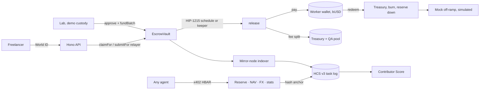
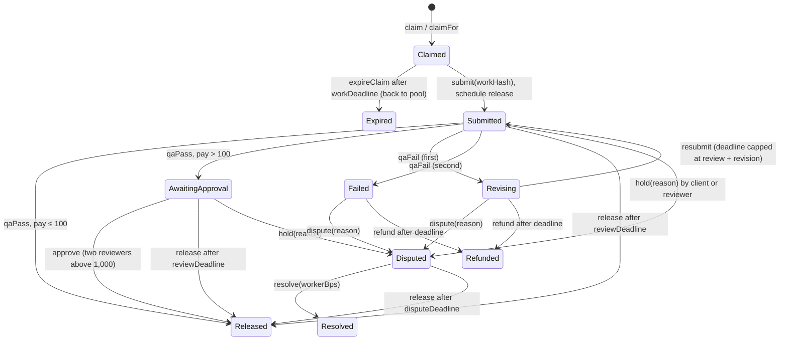

# Byline Work

**Escrowed, cross-border pay for the people who train AI. The money is locked before the work starts, and silence pays the freelancer.**

An AI lab locks **bUSD** (a Stablecoin Studio stablecoin on Hedera) in `EscrowVault` before anyone can claim a task. A World ID–verified freelancer claims, submits a hash of the work, and a Hedera **scheduled transaction** is created for the review deadline. QA passes, a reviewer approves, or nobody acts — in every case the worker is paid on-chain. Every transition is a public **HCS** message that feeds a portable Contributor Score, and any agent can buy signed reserve, NAV, FX and escrow data over **x402**.

ETHGlobal Mumbai 2026 · Hedera (Stablecoin Studio, HTS, HIP-1215 / HIP-423 scheduling, HCS, x402) · World ID · 0G

> Testnet only. The lab, relayer and reviewer keys are **demo custody**: the server holds them, and every response says so. See [Security model](#security-model).

---

## For reviewers: what to look at

| Claim | Where | Evidence |
|---|---|---|
| Funds are locked before work, admin cannot touch them | [`contracts/src/EscrowVault.sol`](contracts/src/EscrowVault.sol) | `test_admin_cannot_touch_locked_task`, `invariant_solvency` |
| Silence pays the worker (review, approval, dispute timeouts) | `release`, `releaseIfDue` | `test_timeout_from_submitted`, `test_timeout_from_awaiting_approval`, `test_dispute_timeout_pays_worker` |
| A reviewer can stop a payout only with an on-chain reason | `hold`, `_dispute` | `test_hold_without_reason_reverts`, `test_dispute_without_reason_reverts` |
| Over 1,000 bUSD needs two different reviewers, and still can't stall | `approve`, `firstApprover` | `test_dual_review_needs_two_distinct_reviewers`, `test_dual_review_does_not_block_timeout` |
| Every split conserves `pay + fee` to the base unit | `resolve`, `_payWorker`, [`packages/shared/src/fee.ts`](packages/shared/src/fee.ts) | `testFuzz_resolve_conserves`, `testFuzz_release_conserves`, `fee.test.ts` |
| A frozen or paused payout reverts cleanly and is retried | `releaseIfDue` + [`keeper.ts`](apps/api/src/keeper.ts) | `test_frozen_worker_reverts_and_keeps_state` |
| Claims over 100 bUSD can't skip the World ID step-up | `DirectClaimTooLarge`, [`work.ts`](apps/api/src/work.ts) `claim` | `test_direct_claim_above_threshold_reverts` |
| The TS ABI the indexer decodes with matches the compiled contract | [`escrow-abi.ts`](packages/shared/src/escrow-abi.ts) | `abi.test.ts` (diffs against `contracts/out`) |
| A World ID `sub` never reaches HCS | [`packages/shared/src/hcs.ts`](packages/shared/src/hcs.ts) | `hcs.test.ts` |
| Server-held keys can't be turned against platform accounts | [`routes.ts`](apps/api/src/routes.ts), [`config.ts`](apps/api/src/config.ts) | `routes.test.ts` |

### Verify in two commands (no keys, no network)

```bash
npm ci && npm run check          # typecheck every workspace + 35 TS tests
cd contracts && forge test       # 42 Solidity tests: unit, fuzz (256 runs), invariant (640 calls)
```

CI runs both on every push ([`.github/workflows/ci.yml`](.github/workflows/ci.yml)), feeds the freshly compiled ABI into the drift test, and builds the web app.

---

## How it works



### Escrow state machine



**Money per task.** The lab funds `pay + fee` (`fee = pay × 3%`). Released: worker gets `pay`, the fee splits treasury / QA pool. Refunded: the lab gets `pay + fee` back. Resolved: the worker gets `pay × workerBps`, the fee is charged only on that share, the lab gets the rest. Rounding dust goes to the treasury.

The keeper runs every 15 s in every scheduling mode: it expires claims, refunds closed revision windows, pays unresolved disputes to the worker, and retries a release that reverted. `ESCROW_SCHEDULING` picks how the deadline release is scheduled: `hip1215` (inside the contract), `sdk` (`ScheduleCreate` with `waitForExpiry`, see [`schedule.ts`](apps/api/src/schedule.ts)), or `keeper` only. `release` is permissionless, so the schedule is a convenience, not a trust assumption.

### x402 data service

| Endpoint | Returns | Price |
|---|---|---|
| `GET /x402/busd/reserve` | supply, reserve, ratio, last reserve tx | 0.001 HBAR |
| `GET /x402/busd/nav` | NAV (reserve ÷ supply) with history | 0.001 HBAR |
| `GET /x402/fx/:pair` | USD-INR / USD-PHP / USD-NGN, source labelled | 0.001 HBAR |
| `GET /x402/escrow/stats` | value locked, tasks by state, median seconds to pay, auto-release share, dispute rate | 0.005 HBAR |
| `GET /x402/client/:id/stats` | one lab's funding history, median seconds to pay, hold rate, dispute outcomes | 0.005 HBAR |

Every body is signed (EIP-191 over a canonical statement, [`feed-sig.ts`](packages/shared/src/feed-sig.ts)) and its hash is anchored on HCS. `npm run buy-nav` pays as an outside agent and verifies both.

---

## Run on testnet

Node ≥ 22.13 (24 recommended). Foundry for the contract.

```bash
npm install
cp .env.example .env
# Fill OPERATOR_ACCOUNT_ID / OPERATOR_PRIVATE_KEY from https://portal.hedera.com
npm run keys          # fills every empty key slot in .env (feed signer + one ECDSA key per role). Prints no keys.
npm run accounts      # creates the role accounts (EVM alias, unlimited auto-association), writes ids to .env
npm run topic         # HCS topic, operator submit key, no admin key, writes HCS_TOPIC_ID
npm run busd          # needs SCS_FACTORY_ADDRESS / SCS_RESOLVER_ADDRESS; writes BUSD_* from the SDK
cd contracts && forge build && cd ..
npm run deploy:escrow # ContractCreateFlow, associates bUSD, grants roles, writes ESCROW_*
npm run lifecycle -- kyc <escrow-or-account-id>
npm run demo-seed     # 1000 bUSD deposit, batches A/B/C, claim+submit the timeout task
npm run dev:api       # API on :8787, indexer ~3 s, keeper 15 s
npm run dev:web       # web on :3000, proxies /api and /x402 to the API
npm run e2e           # instant, approved, timeout paths with exact balances and an HCS message per transition
npm run buy-nav       # pays 0.001 HBAR over x402, checks the signature and the HCS anchor
npm run score         # Contributor Score from the mirror node only
```

Every setup script is idempotent and skips what `.env` already has. Scripts that need missing keys stop and name them; none invents a token id or address.

Issuer lifecycle (`npm run lifecycle -- …`), each signed by its own role account:

| Command | Who signs | What |
|---|---|---|
| `deposit <account> <bUSD>` | admin, then cash-in | reserve up, then mint |
| `kyc <account>` | compliance | grant KYC |
| `freeze` / `unfreeze <account>` | compliance | token freeze |
| `pause` / `unpause` | admin | whole token |
| `redeem <account> <bUSD>` | holder, then burn | transfer to treasury, burn, reserve down |

Redeem wipes only if the SDK burn throws. The API route then quotes the FX cache and returns **₹ credited (simulated)**.

### Deployed on testnet

The setup scripts print and write the real ids; this table is filled from them, never invented.

| What | Env | HashScan |
|---|---|---|
| bUSD | `BUSD_TOKEN_ID` | `https://hashscan.io/testnet/token/<BUSD_TOKEN_ID>` |
| Stablecoin proxy | `BUSD_SCS_PROXY` | `https://hashscan.io/testnet/contract/<BUSD_SCS_PROXY>` |
| Reserve | `BUSD_RESERVE_ADDRESS` | `https://hashscan.io/testnet/contract/<BUSD_RESERVE_ADDRESS>` |
| Escrow | `ESCROW_CONTRACT_ID` | `https://hashscan.io/testnet/contract/<ESCROW_CONTRACT_ID>` |
| HCS topic | `HCS_TOPIC_ID` | `https://hashscan.io/testnet/topic/<HCS_TOPIC_ID>` |
| A schedule | `0.0.x` from a submit | `https://hashscan.io/testnet/schedule/<schedule-id>` |

---

## Security model

What the code enforces, and what it deliberately does not.

**On-chain (holds even if the server is malicious).** The admin can pause new batches and claims only; no role can move locked funds. `release` and `refund` are permissionless after their deadlines. A hold or dispute needs a non-zero reason hash. Above `DUAL_REVIEW_THRESHOLD` an approval needs two distinct `REVIEWER` addresses. Direct `claim` reverts above 100 bUSD, so the step-up can't be skipped. The payout address is fixed at claim time, so a takeover can't redirect earned pay. Reentrancy guard on every function that moves tokens; token transfer results are checked.

**Server guards (tested in [`routes.test.ts`](apps/api/test/routes.test.ts)).**
- Redeem signs only with a demo *worker* wallet key (`WORKER_A`, `WORKER_B`, `WORKER_RENTED`), never with the treasury, lab or any other role.
- Payout binding refuses platform role accounts and any wallet already bound to another worker.
- Freeze and fraud actions refuse the escrow, the token, and every platform role account (the spec's "never freeze the escrow").
- A desk header that is not on `LAB_ALLOWLIST` / `REVIEWER_ALLOWLIST` gets 403.
- Malformed ids, amounts and basis points are 400s before any chain call. Unhandled errors return a generic JSON 500, never a stack.
- Logout clears the server session, not just the cookie. Sessions are `httpOnly`, `SameSite=Lax`, `Secure` when `SESSION_SECURE=1`.
- World ID: PKCE, state and nonce bound to the browser session, single-use step-up approvals with a TTL, `auth_time` freshness and `acr` checks. The `sub` stays in SQLite; the HCS schema rejects it.

**Demo custody, stated plainly.** The lab, reviewer and compliance desks are server-held keys. Their routes accept requests without a login so the demo runs by clicking; a header, when present, must be on the allowlist. In production those desks sign with their own wallets, and the server would only relay.

## Gap 9: a release can revert and stay due

`release` pays the worker and the fee split in one transaction. If the worker is frozen or not KYC'd, or bUSD is paused, the token transfer reverts and the escrow state does not change: the task stays `Submitted`, `AwaitingApproval` or `Disputed`, and the locked bUSD stays put. The scheduled call targets `releaseIfDue`, which catches that revert and returns false so the schedule itself succeeds. The keeper retries every 15 s. On confirmed fraud a reviewer resolves the task as a refund instead of waiting on a frozen payout. The escrow, treasury and QA pool are never frozen.

## Identity and QA

Auto QA grades gold answers and a rubric checklist immediately; manual batches are never auto-passed (that is how the timeout scene is shown). 0G is called only when `ZG_API_KEY` is set, and `teeVerified` is copied from the provider trace, never set to true by this server. A QA call that keeps failing stops after 5 attempts and the deadline pays the worker.

`DEMO_MOCK_WORLD=1` creates a worker labelled **demo human**. That row is not a World ID and cannot claim tasks over 100 bUSD.

## What we do not claim

| We do not say | Because | We say instead |
|---|---|---|
| "Instant cash in your bank account" | The demo off-ramp is simulated, and real ones depend on licensed partners | "Paid in dollars in seconds. Converting to local currency plugs in through partners." |
| "Fully trustless" | The QA oracle and reviewers are trusted roles | "Funds are locked on-chain, every decision is public, and timeouts favour the worker." |
| "Human-made data" | World ID proves an accountable person, not that they did it without AI | "A real, accountable human did and stands behind every task." |
| "No regulation needed" | Issuing a stablecoin, KYC and cross-border payouts are regulated activities | "Built with the compliance controls a regulated issuer would need." |
| "Tax-free" | Many countries tax crypto payouts. India, for example, has specific rules for virtual digital assets | "Freelancers get a full HCS record of every payment for their tax filings." |

## Layout

| Path | What |
|---|---|
| `contracts/` | `EscrowVault.sol`, HIP-1215 interface, mocks, Foundry unit / fuzz / invariant tests |
| `packages/shared` | bUSD units, fee math, escrow ABI, HCS v3 schemas, Contributor Score, feed signatures, x402 payer |
| `apps/api` | Hono API, mirror-node indexer, keeper, QA oracle, World ID, x402 resource server, mock off-ramp |
| `apps/web` | Next.js desks: `/lab`, `/work`, `/review`, `/transparency` |
| `stablecoin/` | Stablecoin Studio create and issuer lifecycle |
| `scripts/` | testnet toolchain: keys, accounts, topic, deploy, seed, e2e, buy-nav, score |
| [`BYLINE_WORK.md`](BYLINE_WORK.md) | product spec |
| [`BYLINE_WORK_BUILD.md`](BYLINE_WORK_BUILD.md) | decisions, spec gaps closed, requirements |

### Reused from Byline v2

v2 lives in `../ETHGM/Build`. Ported and renamed for workers, tasks and feeds: config/db boot-on-partial-env, World ID login and step-up (`claim_high`, `payout_wallet`), the HCS submit/reader, the x402 server and payer, the 0G client, EIP-191 feed attestations, units and HashScan helpers, daily caps and bans, and the key/account/topic scripts. Not brought over: Arkiv, the ask pipeline, budget, citations, authenticity.

New here: the escrow and its client, the mirror-node indexer, the keeper, SDK and HIP-1215 scheduling, dual review, gold-question QA, the Contributor Score, client stats, the mock off-ramp, and the Stablecoin Studio scripts.

## License

[MIT](LICENSE)
