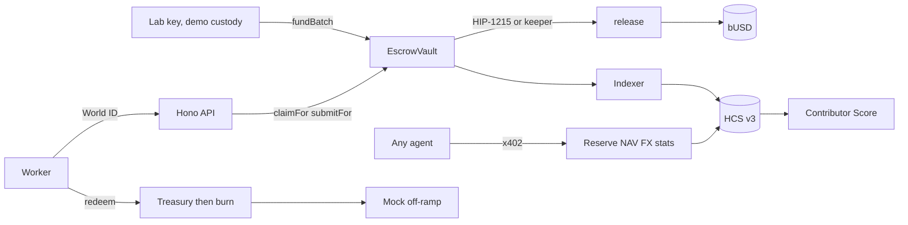

# Byline Work

A freelancer in Pune reviews work for an AI lab. The lab locks **bUSD** in an escrow before anyone starts. Silence pays the worker. Every transition is a public HCS message, and any agent can buy a signed reserve, NAV, or FX feed over x402.

bUSD is a testnet USD stablecoin from Hedera Stablecoin Studio (6 decimals, KYC, freeze, pause, wipe, a demo reserve, and a 1-tinybar HBAR custom fee). The 3% platform fee stays inside `EscrowVault`: it is charged only on the worker's share, and a refund returns pay plus fee. The HBAR fee cannot skim the escrow's bUSD balance.

This repo is testnet only. The lab key, the relayer, and the reviewer key are **demo custody**: the server holds them, and responses say so.

## Run

Node 24. From this folder:

```bash
npm install
cp .env.example .env
npm run preflight     # what is configured, and what each testnet step still needs
npm run keys          # FEED_SIGNER_KEY
npm run accounts      # ECDSA accounts, EVM alias, unlimited auto-association
npm run topic         # HCS topic, operator submit key, no admin key
```

Fill `OPERATOR_ACCOUNT_ID` / `OPERATOR_PRIVATE_KEY` from the Hedera portal before `accounts` and `topic`. Paste the printed lines into `.env`. Do not commit `.env`.

Stablecoin Studio needs the testnet factory and resolver (`SCS_FACTORY_ADDRESS`, `SCS_RESOLVER_ADDRESS`). Those are deployment addresses, not a token id.

```bash
npm run busd          # prints BUSD_TOKEN_ID, BUSD_SCS_PROXY, BUSD_RESERVE_ADDRESS from the SDK
```

Build the escrow first: `cd contracts && forge build` writes `contracts/out`, which `deploy:escrow` reads.

```bash
npm run deploy:escrow # ContractCreateFlow, constructor args with no selector
npm run lifecycle -- kyc 0.0.xxxx
npm run demo-seed     # 1000 bUSD deposit, batches A/B/C, claim+submit the timeout task
npm run dev:api       # indexer ~3s, keeper 15s. Do not start it if the web app needs the port.
npm run e2e           # instant, approved, timeout. Exact balances. HCS per transition.
npm run buy-nav       # pays 0.001 HBAR, checks the signature and the HCS anchor
npm run score         # Contributor Score from the mirror node only
npm run demo:frozen-transfer   # fraud scene: a frozen account's transfer is refused
npm test
npm run typecheck
```

`demo-seed`, `e2e`, `buy-nav`, and `busd` stop with the missing variable names when Hedera keys or the token are not set. They do not invent a token id.

Lifecycle (`npm run lifecycle -- …`):

| Command | Who signs | What |
|---|---|---|
| `deposit <account> <bUSD>` | admin, then cash-in | reserve up, then mint |
| `kyc <account>` | compliance | grant KYC |
| `freeze` / `unfreeze <account>` | compliance | token freeze |
| `pause` / `unpause` | admin | whole token |
| `redeem <account> <bUSD>` | holder, then burn | transfer to treasury, burn, reserve down |

Redeem wipes only if the SDK burn throws. The API route then quotes the FX cache and returns the text **₹ credited (simulated)**.

## What was reused from Byline v2

v2 lives in `../ETHGM/Build`. These shapes were ported and renamed for workers, tasks, and feeds:

| v2 | here |
|---|---|
| `apps/api/src/config.ts`, `db.ts` | same boot-on-partial-env pattern, new tables |
| `apps/api/src/world.ts` | worker login, step-up actions `claim_high` and `payout_wallet` |
| `apps/api/src/hcs.ts` | generic submit plus a v3 reader |
| `apps/api/src/payments.ts` | `apps/api/src/oracle/x402.ts` (static tinybar prices, operator payee) |
| `packages/agent/src/payer.ts` | `packages/shared/src/x402-payer.ts` |
| `packages/agent/src/zg.ts` | `apps/api/src/qa/zg.ts` |
| `packages/shared/src/attestation.ts` | `packages/shared/src/feed-sig.ts` (EIP-191 feed statement) |
| `packages/shared/src/hedera.ts`, `units.ts` | same, plus bUSD base units and contract, schedule, and token links |
| `apps/api/src/moderation.ts` | `apps/api/src/caps.ts` (daily claim cap and bans) |
| `scripts/gen-keys.ts`, `create-accounts.ts`, `create-topic.ts`, `pay-once.ts` | `scripts/`, with `pay-once` becoming `buy-nav` |

Not brought over: Arkiv, the ask pipeline, budget, citations, and authenticity.

New in this repo: the escrow contract, the escrow client, the mirror-node indexer, the keeper, SDK scheduling, gold-question QA, the Contributor Score and score tiers, the mock off-ramp, and the Stablecoin Studio scripts.

## Status

Written and tested locally. On testnet so far: the HCS topic, the role accounts and bUSD (token `0.0.11340549`). The escrow is deployed (`0.0.11341621`, [HashScan](https://hashscan.io/testnet/contract/0.0.11341621)) and a task has been paid by its HIP-1215 schedule with no keeper running. `npm run e2e` has not been run yet, and the source is not verified on HashScan. `forge test` (46 tests: 41 unit and fuzz, 5 invariants), `npm test` (40) and `npm run typecheck` pass, but those use a mock token and a mock schedule service. The HIP-1215 schedule call and the Stablecoin Studio SDK calls are unproven until the spikes in `BYLINE_WORK_BUILD.md` run. `npm run e2e` fails, rather than passing quietly, if the schedule does not fire and only the keeper paid.

## Reviewers and large payouts

Above `HITL_THRESHOLD` (100 bUSD) a payout waits for a reviewer, and a reviewer can only stop it with an on-chain hold and a reason. Silence still pays the worker at the deadline. Above `DUAL_REVIEW_THRESHOLD` (1,000 bUSD) an early payout needs two distinct reviewers: set `REVIEWER2_*` and `deploy:escrow` grants the role and sets the threshold. The second approval comes from the second reviewer account (`x-byline-account` header).

The lab and review desks are demo desks. Without that header they use the first allowlisted account, so **do not expose this API publicly**. The `/api/fraud` and `/api/compliance/freeze` routes have no login at all.

## x402 data service

| Route | Returns |
|---|---|
| `/x402/busd/reserve` | supply, reserve, ratio, last update |
| `/x402/busd/nav` | reserve ÷ supply, with history |
| `/x402/fx/:pair` | USD-INR, USD-PHP, USD-NGN from a public FX source |
| `/x402/escrow/stats` | value locked, tasks by state, median seconds to pay, auto-release share, dispute rate |
| `/x402/client/:id/stats` | a lab's funding history, median seconds to pay, share paid, hold rate |

Every response is EIP-191 signed and its hash is anchored on HCS.

## Architecture



The keeper runs every 15 seconds in every scheduling mode. It expires claims, refunds closed revision windows, pays unresolved disputes to the worker, and retries a release that reverted. `apps/api/src/schedule.ts` sends `ScheduleCreate` with `waitForExpiry` only when `ESCROW_SCHEDULING=sdk`.

Direct `claim` on the contract is only valid at or below 100 bUSD (`100_000_000` base units). The API always uses the relayer. Above 100 bUSD the relayer also requires a single-use `claim_high` approval whose target is the batch id. The payout address is stored on the task at claim. A later wallet change applies to new claims only.

Auto QA grades gold answers and a rubric checklist immediately. Manual batches are never auto-passed. 0G is called only when `ZG_API_KEY` is set. It is advisory: its verdict, request id and `teeVerified` (copied from the provider trace, never set to true by this server) are stored in the report, and a disagreement is flagged, but the outcome comes from the deterministic grade alone.

A World ID `sub` is stored in SQLite and rejected by the HCS schema. It is not written to events or public JSON. `DEMO_MOCK_WORLD=1` can create a worker labelled **demo human**. That row is not a World ID.

## HashScan

Fill these after `busd`, `topic`, and `deploy:escrow`. The scripts print the real ids.

| What | Env | HashScan |
|---|---|---|
| bUSD | `BUSD_TOKEN_ID` | `https://hashscan.io/testnet/token/<BUSD_TOKEN_ID>` |
| Stablecoin proxy | `BUSD_SCS_PROXY` | `https://hashscan.io/testnet/contract/<BUSD_SCS_PROXY>` |
| Reserve | `BUSD_RESERVE_ADDRESS` | `https://hashscan.io/testnet/contract/<BUSD_RESERVE_ADDRESS>` |
| Escrow | `ESCROW_CONTRACT_ID` | `https://hashscan.io/testnet/contract/<ESCROW_CONTRACT_ID>` |
| HCS topic | `HCS_TOPIC_ID` | `https://hashscan.io/testnet/topic/<HCS_TOPIC_ID>` |
| A message | sequence from the API | `https://hashscan.io/testnet/topic/<HCS_TOPIC_ID>/message/<sequence>` |
| A transaction | tx id | `https://hashscan.io/testnet/transaction/<mirror-tx-id>` |
| A schedule | `0.0.x` from a submit | `https://hashscan.io/testnet/schedule/<schedule-id>` |
| Operator | `OPERATOR_ACCOUNT_ID` | `https://hashscan.io/testnet/account/<OPERATOR_ACCOUNT_ID>` |

The contract is **not verified on HashScan yet**. After `deploy:escrow`, verify the source through HashScan's contract verification and add the link above. This README does not invent that link.

## Gap 9: a release can revert and stay due

`release` pays the worker and the fee split in one transaction. If the worker is frozen or not KYC'd, or if bUSD is paused, the token transfer reverts. The escrow state does not change: the task stays `Submitted`, `AwaitingApproval`, or `Disputed`, and the locked bUSD stays put. The scheduled call uses `releaseIfDue`, which catches that revert and returns false so the schedule itself succeeds. The keeper retries on its next 15 second tick. Timeouts resume once the account is unfrozen or the token is unpaused. On confirmed fraud a reviewer resolves the task as a refund instead of waiting on a frozen payout. The escrow, the treasury, and the QA pool are not frozen.

## What we do not claim

| We do not say | Because | We say instead |
|---|---|---|
| "Instant cash in your bank account" | The demo off-ramp is simulated, and real ones depend on licensed partners | "Paid in dollars in seconds. Converting to local currency plugs in through partners." |
| "Fully trustless" | The QA oracle and reviewers are trusted roles | "Funds are locked on-chain, every decision is public, and timeouts favour the worker." |
| "Human-made data" | World ID proves an accountable person, not that they did it without AI | "A real, accountable human did and stands behind every task." |
| "No regulation needed" | Issuing a stablecoin, KYC and cross-border payouts are regulated activities | "Built with the compliance controls a regulated issuer would need." |
| "Tax-free" | Many countries tax crypto payouts. India, for example, has specific rules for virtual digital assets | "Freelancers get a full HCS record of every payment for their tax filings." |

## Layout

`packages/shared` holds units, fee math, the escrow ABI, HCS v3 schemas, the score, feed signatures, and the x402 payer. `apps/api` is the Hono server, indexer, keeper, QA, and x402 resource server. `stablecoin/` creates bUSD and runs the issuer lifecycle. `scripts/` is the testnet toolchain. `contracts/` is the Foundry project (`EscrowVault.sol` and mocks). `apps/web/` is the Next app (`/lab`, `/work`, `/review`, `/transparency`).
